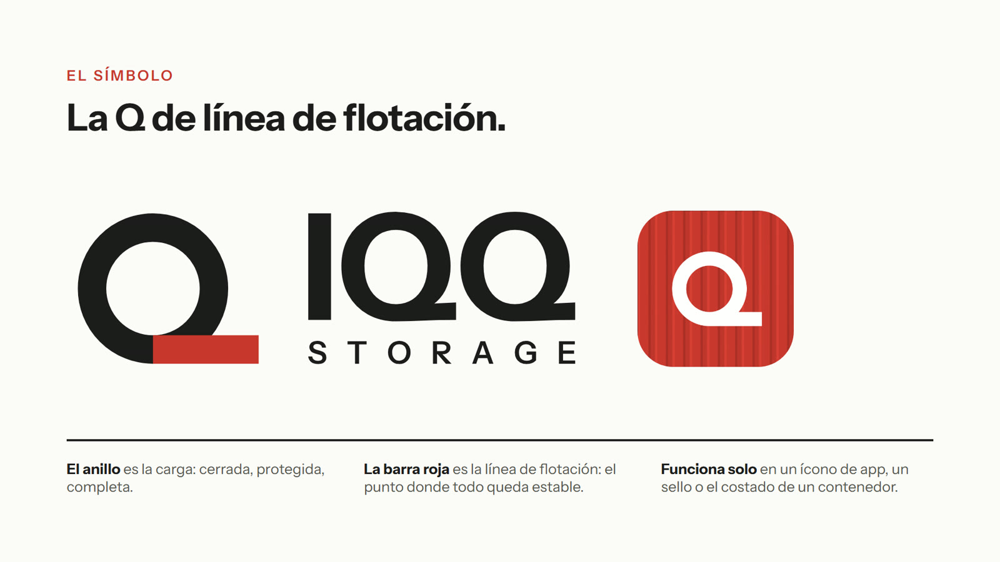
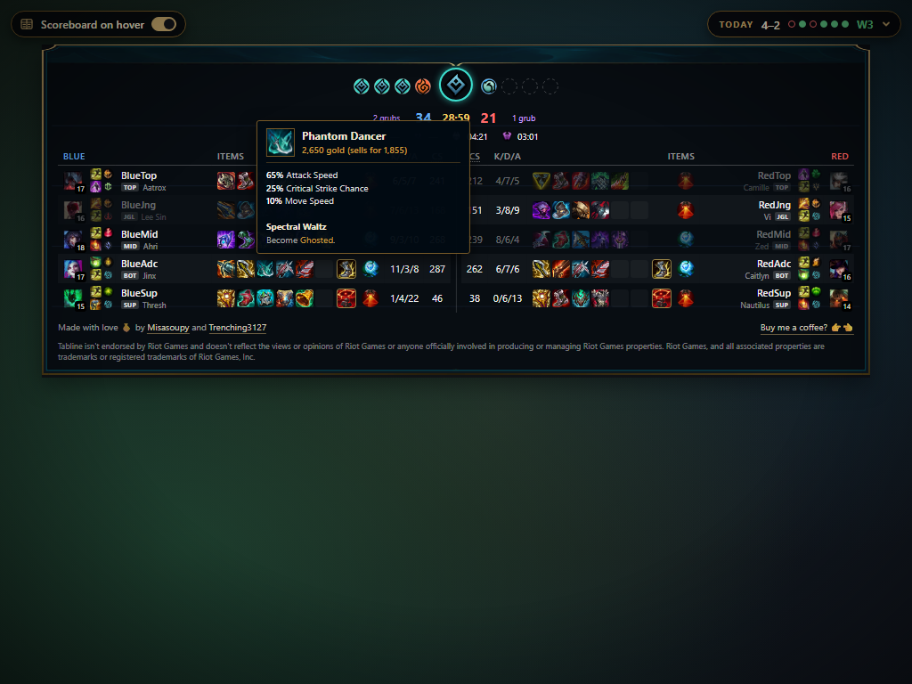
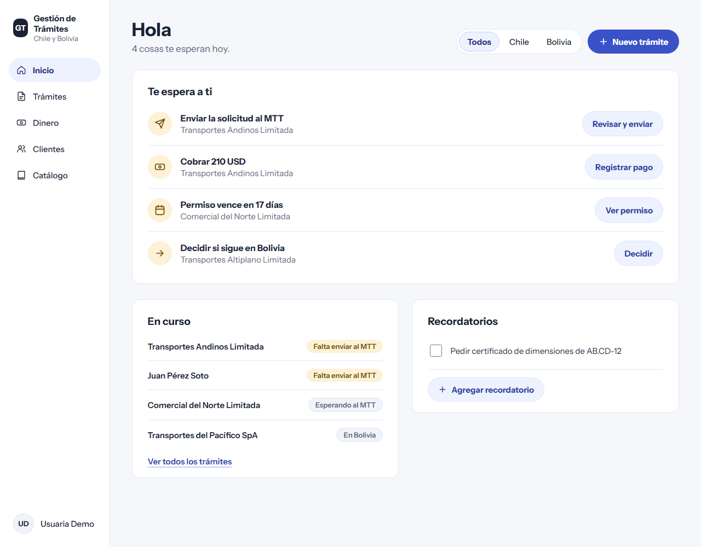

# Product Portfolio — Misa Escalera

Product work from discovery to shipped software. For each project I talked to the users, wrote the spec, designed and built a working version, and checked it against what they told me.

The source code of client projects is private. This repo holds the **product work**: PRDs, discovery findings, interview guides, go-to-market plans, pitch decks, brand identities and screenshots. Names of client staff and their customers are replaced with role names or fake ones.

## Projects

| | Project | What it is | Product documents | Status |
|---|---|---|---|---|
|  | [**Sistema Gastos**](sistema-gastos/) | Replacing a legacy desktop (Visual FoxPro) cost and billing system for a logistics company (Chile → Bolivia) with a web app plus mobile modules | [PRD](sistema-gastos/PRD.md) · [Discovery findings](sistema-gastos/discovery-findings.md) · [Validation call script](sistema-gastos/validation-call-script.md) · [Product brief](sistema-gastos/product-brief.md) · [Launch checklist](sistema-gastos/production-checklist.md) | v0 live with the client, in validation |
|  | [**IQQ Storage brand**](iqq-storage-brand/) | New brand identity for the same logistics company, pitched with its digital roadmap | [Brand proposal deck](iqq-storage-brand/) | Presented Oct 2026 |
|  | [**Paso**](paso/) | Client paperwork tracker that moves a family import/export business off WhatsApp-only chaos | [PRD](paso/PRD.md) · [Product brief](paso/product-brief.md) · [GTM plan](paso/GTM.md) · [Brand](paso/#naming-and-brand) | Live at [holapaso.com](https://holapaso.com) |
|  | [**Tandem**](tandem/) | One school day for students, families and teachers; pilot pitched to a Texas school network | [Implementation and compliance plan](tandem/implementation-and-compliance-plan.md) · [Pitch deck](tandem/#the-pitch-deck) · [GTM](tandem/#go-to-market-thinking) | Prototype; pilot proposed |
|  | [**Tabline**](tabline/) | Live League of Legends scoreboard over Twitch streams (extension, Windows app, backend, website) | [Product brief](tabline/product-brief.md) · [GTM plan](tabline/GTM.md) · [Website requirements](tabline/website-requirements.md) · [Riot API key application](tabline/riot-production-key-application.md) | In Twitch Hosted Test; Riot key in review |
|  | [**Gestión de Trámites**](gestion-tramites/) | UX audit, redesign and brand options for a transport-permits app (Chile ↔ Bolivia) | [Audit and redesign](gestion-tramites/) | Proposal delivered |
|  | [**Ghosty Bingo**](ghosty-bingo/) | Real-time bingo and birthday-card wall for a friend's birthday game night | [PRD](ghosty-bingo/PRD.md) · [Product brief](ghosty-bingo/product-brief.md) | Shipped for the event (Sep 2026) |
| | [**Personal portfolio**](https://github.com/misaelaneo/misaescalera) | My portfolio site | [PRD](https://github.com/misaelaneo/misaescalera/blob/main/Documentation/PRDs/personal_portfolio_prd.md) | Live at [misaescalera.com](https://misaescalera.com) |

## Where to start

- **Short on time?** Read the **Sistema Gastos [PRD](sistema-gastos/PRD.md)**. It shows the whole process in one document: problems backed by timestamps from the recorded discovery call, every claim marked **[Confirmed]** or **[Assumed]**, a legacy → new screen mapping with screenshots, prioritized requirements, open questions that become settings, success measures and a phased plan.
- **Go-to-market:** [Paso GTM](paso/GTM.md) (B2B, from one customer to a vertical), [Tabline GTM](tabline/GTM.md) (platform gates and free distribution), and the [Tandem pilot plan](tandem/implementation-and-compliance-plan.md) (selling into a regulated school district).
- **Brand and design:** [IQQ Storage](iqq-storage-brand/), [Paso](paso/#naming-and-brand) and [Gestión de Trámites](gestion-tramites/#brand-options).

## AI features and MCP

| Project | What I built | Where it's specified |
|---|---|---|
| **Paso** | An **MCP server** so teams can run Paso from Claude, in headless mode or "bridge" mode, where Claude drives the open window. OAuth sign-in, per-person scopes | [PRD addendum](paso/PRD.md#addendum-ai-and-mcp-built-after-v1) · [case study](paso/#ai-paso-inside-claude-mcp-server) |
| **Sistema Gastos** | An in-app **Claude assistant** with 20 tools that answers from live data and fills real forms for a person to save, plus **AI reading of scanned bills of lading** (free OCR and rules first, Claude when switched on) | [PRD §17](sistema-gastos/PRD.md#17-ai-features-added-in-v0) · [case study](sistema-gastos/#ai-features) |
| **Tandem** | A deliberate decision to keep AI **out** of a pilot with minors' school data, and never train models on it | [Case study](tandem/#ai-a-deliberate-not-yet) · [compliance plan](tandem/implementation-and-compliance-plan.md#privacy-by-design) |

The common rule: **the AI prepares, a person confirms.** Assistants never save, delete or invent data on their own.

## How I work

1. **Discover.** Record a working session with the people who do the job, and pull out the problems, the workflow and the edge cases ([example](sistema-gastos/discovery-findings.md)).
2. **Specify.** Write a PRD that separates what was confirmed from what was assumed, with scope, non-goals and success measures ([example](sistema-gastos/PRD.md)).
3. **Build a v0 to learn.** Ship something real early. Every unconfirmed rule is a setting, not hard-coded.
4. **Validate.** Present the v0 and close the open questions screen by screen ([example](sistema-gastos/validation-call-script.md)).
5. **Make decisions and write them down.** For example, Paso's first release used private links instead of the WhatsApp API the spec planned ([why](paso/#key-product-decision)).
6. **Take it to market.** Position it, pick the first segment, and define how success is measured ([example](paso/GTM.md)).
