# Gestión de Trámites — UX audit, redesign and brand

**Client:** a small team that handles transport permits between Chile and Bolivia (applications to Chile's Ministry of Transport, follow-up, billing). Their app was already built and in use.
**My role:** UI/UX audit, architecture audit, redesign proposal and brand identity options.
**Format:** written audits plus a design board of "today" vs "proposed" screens in Spanish. Client and company names in the images are replaced with fake ones.

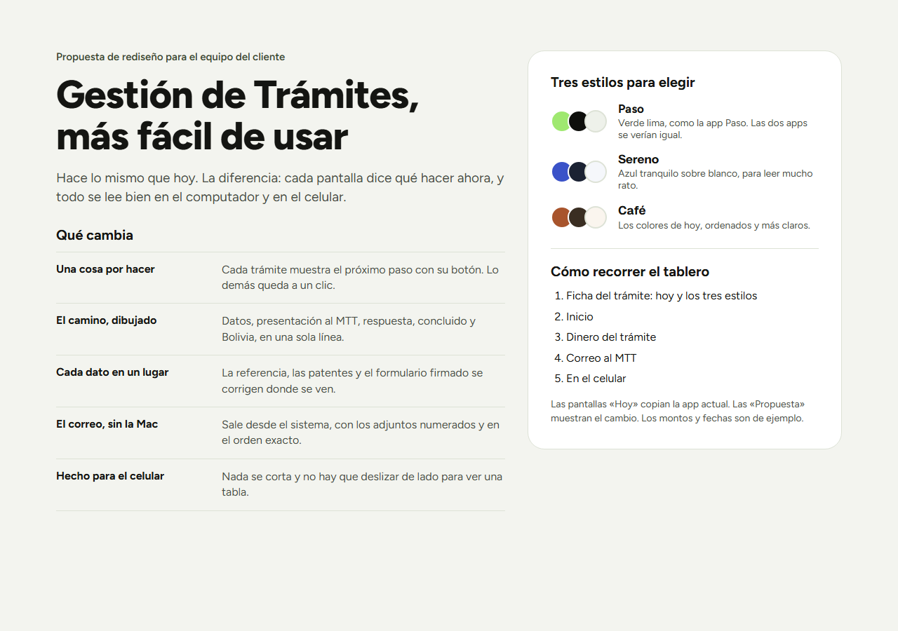

## The audit

I audited the app from its source code against a set of product rules (the same ones behind [Paso](../paso/)), the Web Interface Guidelines, and reference design systems (Wise, Mercury, Linear, Stripe).

**Verdict: solid foundations, too much on every screen.** The app is built better than it looks: real design tokens with AA contrast, money and dates formatted in one place, and tables that turn into cards on a phone. What hurts is density and repetition.

The five changes that matter most:

1. **One next step per job.** The job page's header alone carried about 14 data points.
2. **Every value in one place.** The ministry's reference number, the trucks and the signed form each lived in two or three places, and could be edited in each.
3. **No sideways scrolling on phones.** Eight screens still showed raw tables that scroll sideways at 360 px.
4. **One accent colour, only for the action that moves work forward.** Yellow means "needs you".
5. **Confirm destructive actions.** "Cancel job" ran immediately, with no confirmation or undo.

The fix list was ordered by what needs a decision: fixes that can ship now, fixes that need the brand decision, and fixes that come with the architecture redesign.

## The redesign: today vs proposed

| Home today | Home proposed |
|---|---|
| 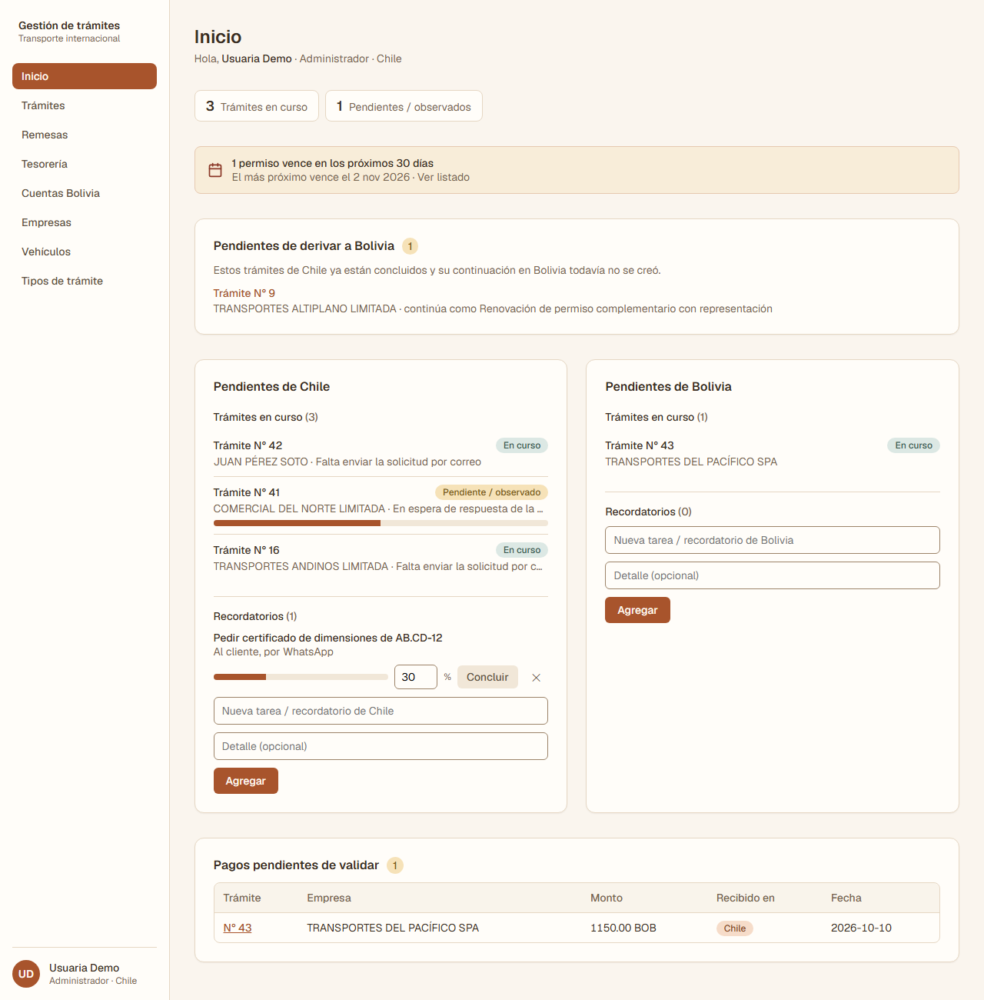 |  |
| Two boards per country, counters, and a table of unformatted amounts | One list of what needs you, sorted by urgency, each row with its button. Country becomes a filter |

| Job page today | Job page proposed |
|---|---|
| 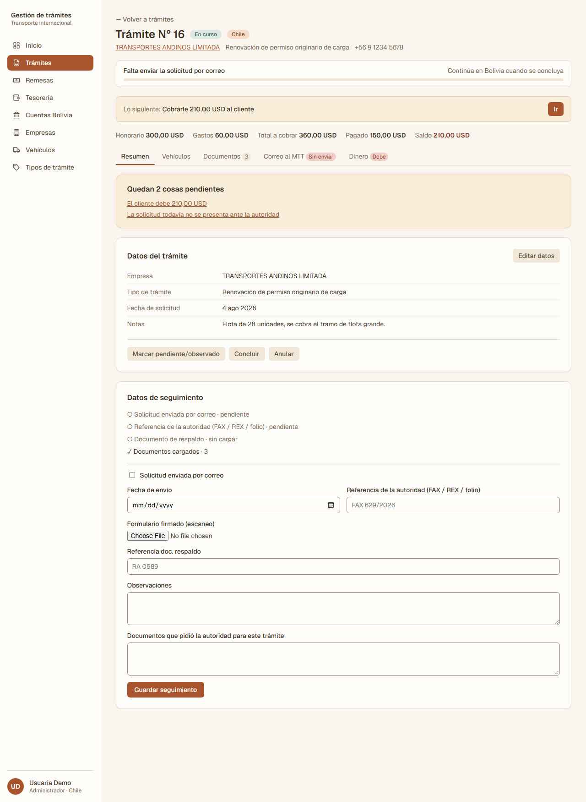 | 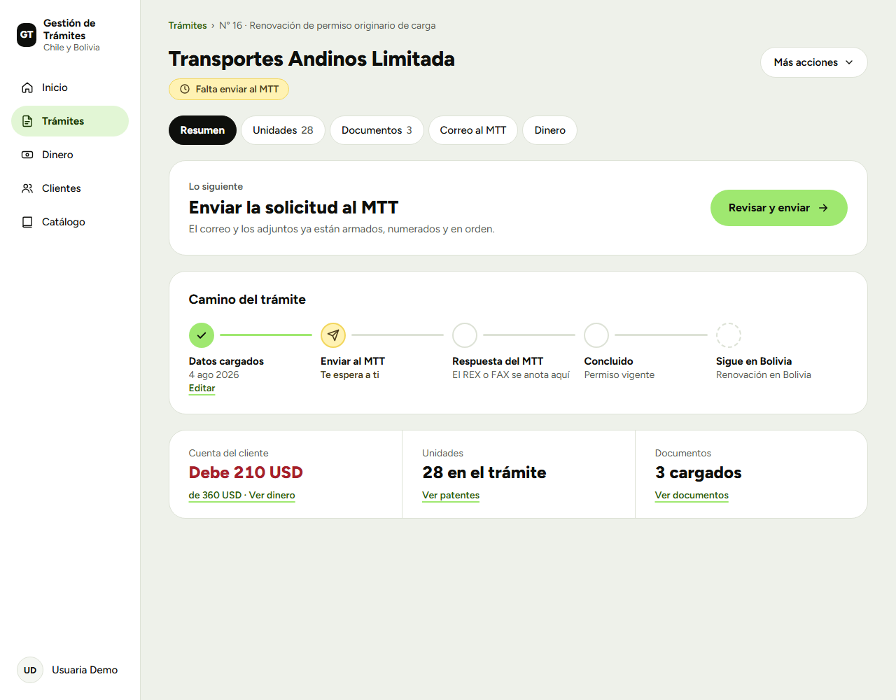 |
| About 14 fields before you start; the same reference in three places | Client and status only, one next step, and the job's path drawn as a line |

| Phone today | Phone proposed |
|---|---|
| 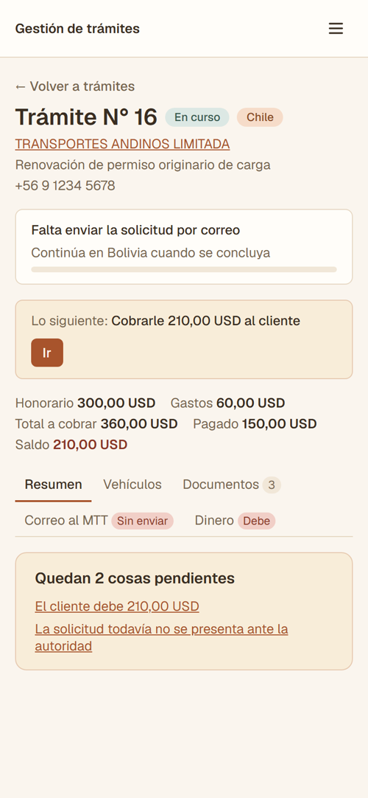 | 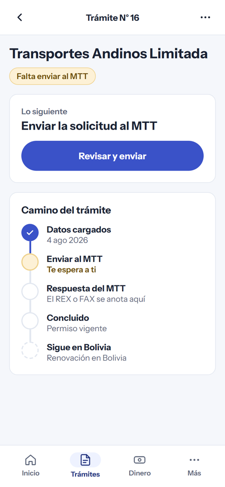 |
| Header and tabs fill the screen before anything useful | Next step on top, the path top to bottom, the menu at the thumb |

The proposal also covers the money screen (how much the client owes, in large type, with one button to record a payment) and sending applications to the ministry from inside the app, with attachments numbered in the exact required order.

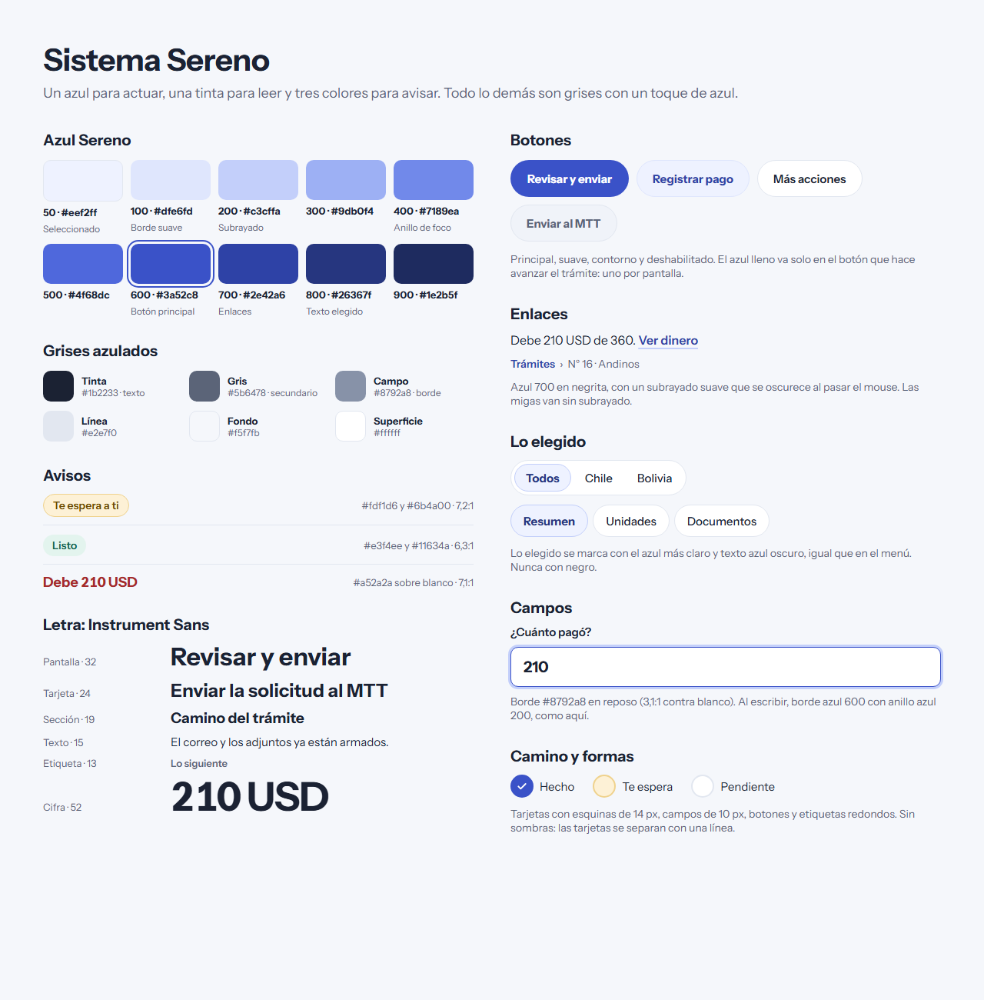

## Brand options

Three directions, each with its own idea, and the one recommended: **Timbre** (the rubber stamp). A simple circle that reads at any size, fills in like a stamp when something is done, and doubles as the status system.

| Recommended: Timbre | Timbre in use |
|---|---|
| 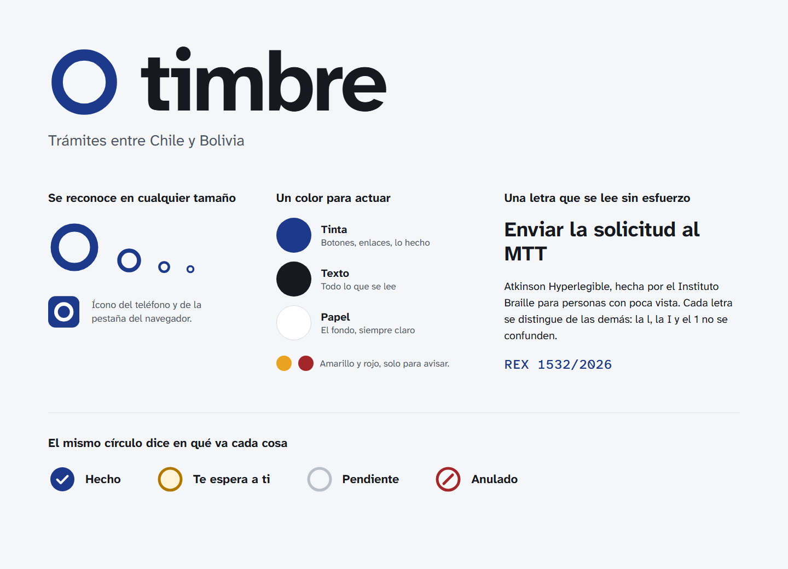 | 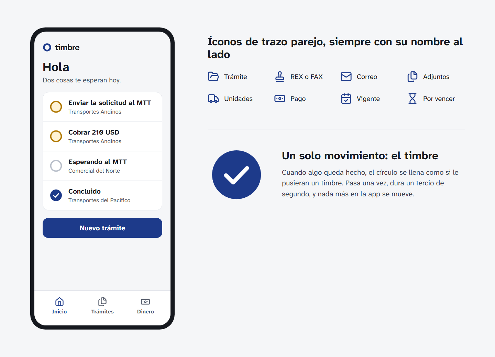 |

| Option 1: La ruta (the mountain road) | Option 2: El timbre, expediente version | Option 3: La señal (road signs) |
|---|---|---|
| 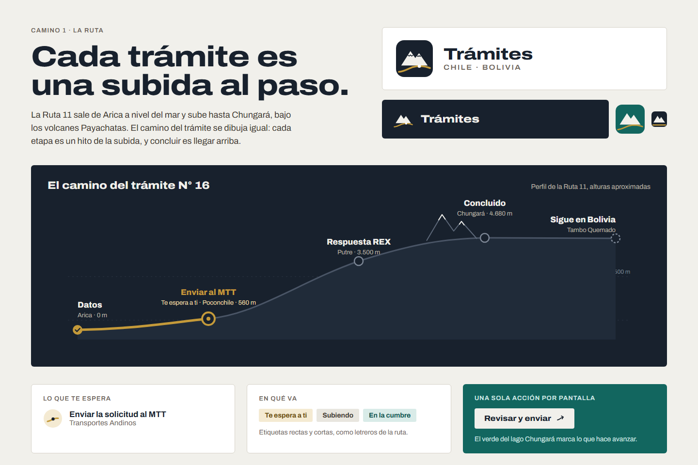 | 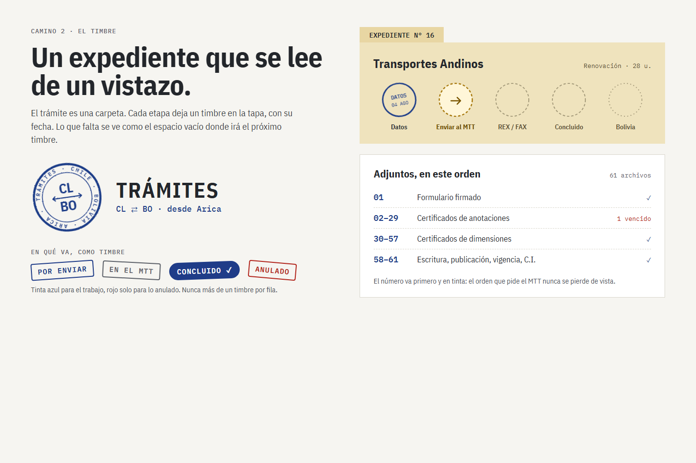 | 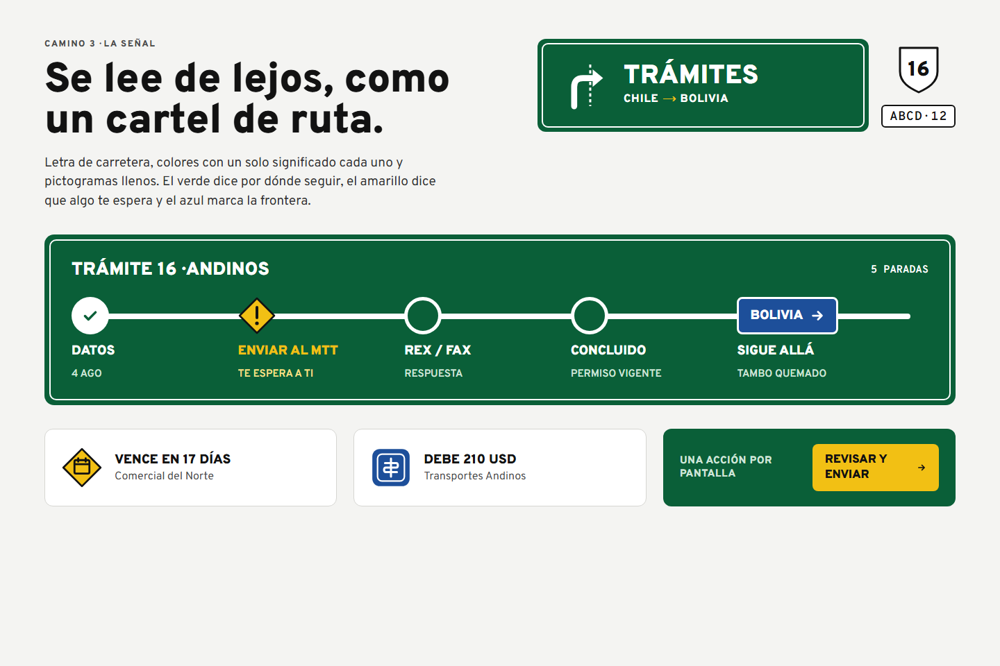 |
