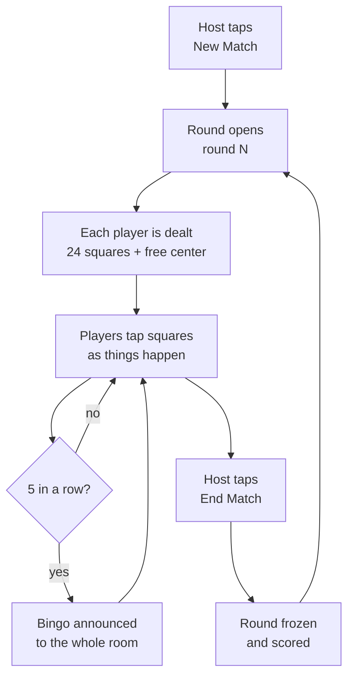
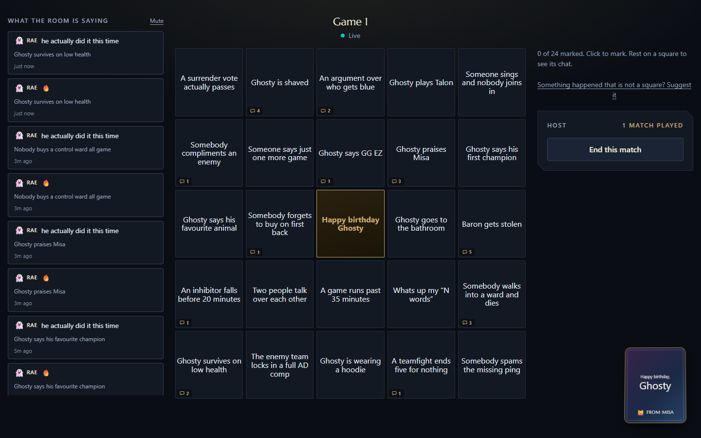
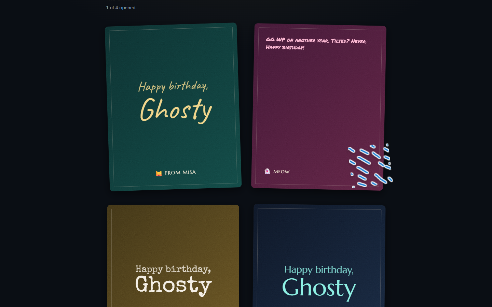

# Ghosty Birthday Bingo — PRD

Sep 21, 2026 · Misa Escalera

A link-and-go web app where friends play League of Legends bingo alongside Ghosty's birthday gaming session: one fresh bingo card per match, everyone marks squares live, and every square hit plus every birthday card written becomes a recap page Ghosty keeps. The party is on Sep 26, 2026.

## Where it stands

Every must-ship feature in this document is built and live at [ghosty-bingo.tabline.workers.dev](https://ghosty-bingo.tabline.workers.dev), four days ahead of the plan. So are both optional features, square submissions and notes and reactions on squares. What is left is a rehearsal on real phones.

| Area | Status | Notes |
| --- | --- | --- |
| Room link, name-only join, live player list | Built | |
| Two-pool draw and cluster caps | Built | Ghosty's card never holds a square about him, checked on the live site |
| Matches, marking, live hit counts | Built | Counts only cover squares on your own card |
| Bingo and the celebration | Built | Names where the line sat, never the square text |
| Birthday card | Built | Stickers work now; GIF search waits on the Giphy key |
| Publishing and the recap page | Built | Refused while a match runs, and cannot be undone |
| Host recovery code and a second host | Built | Added late: the code was shown but could not be used anywhere |
| Square submissions and the approval queue | Built | Suggestions wait marked as about Ghosty, and Ghosty never sees the queue |
| Notes and reactions on squares | Built | Hold a square to open it; only sent for squares on your own card |
| Rename or remove a player | Not built | Not needed for the night. Retiring a square shipped with the queue |
| Tapping squares on a real phone | To test | Only ever tested by script, never by a thumb |

The build carries 22 unit tests and 103 end-to-end checks. The end-to-end suite has also been run against the live site.

## Goals and non-goals

The night works if every friend is playing within 15 seconds of tapping the link, and Ghosty ends up with a page worth re-reading a year later.

Goals:

- One link, no install, no account, no app store. Works in a desktop browser, which is how most people will open it, and on a phone. A browser window snapped beside the game gets the phone layout.
- A fresh card per League match, marked live, visible to everyone in the room.
- Squares that mix League tropes with Ghosty-specific inside jokes.
- Every mark, card and note rolls into a single recap page for Ghosty.
- The host can run the whole night from a phone while also playing.

Non-goals:

- No money, prizes or wagering of any kind.
- No Riot API integration in v1. Rounds are started by a person, not detected.
- No passwords, email verification or profile pages.
- No general-purpose bingo platform. One event, one room, reusable only by accident.
- No native app. Responsive web only.
- No spectator chat. Comments attach to squares, not to a running feed.

## Who needs what

Eight jobs the app has to do. If something is not on this list, it should not be in the scope table further down.

| As | I want to | So that |
| --- | --- | --- |
| A friend arriving late | join from the link with nothing but my name | I am playing before the next game starts |
| A friend in the middle of a ranked game | mark a square with one thumb, in under two seconds | the game does not punish me for playing along |
| A friend who is not playing League tonight | mark, react and write anyway | I am part of the night from the couch |
| A friend who thinks of a better square | add it and see it reach other people's cards | the joke that actually happened becomes part of the game |
| A friend who does not know what to write | be asked once, gently, at a moment when I am not busy | I do not forget to say the thing I came to say |
| The host | start and end a match in one tap while playing my own game | running the night does not cost me the night |
| Ghosty | play a real card I have no way to game, and be surprised at the end | the night is a party, not a ceremony about me |
| Ghosty, a year later | open one link and get all of it back | the night is something I can return to |

The hardest of these is the second. Everything else in this document bends around the fact that most players will be looking at a different screen when they use the app.

## Players and access

Entry is a room code carried in the URL plus a display name. No password, no email, no OAuth.

The link you paste into the group chat is `https://<domain>/r/GHOSTY`. Opening it shows one field: your name. Pick an avatar if you want, tap Join, and you are on a card. The app remembers you on that phone, so a refresh or a lock screen does not cost you your marks.

| Role | How they get in | What they can do |
| --- | --- | --- |
| Player | The room link, then a display name | Mark squares on their own card, add a wish, react to squares, call bingo |
| Host | Created the room, and holds a one-time recovery code | Everything a player can, plus start and end rounds, make another player a host, and publish the recap. Also approve, reject and retire suggested squares. Renaming or removing players is not built |
| Ghosty | The same room link as everyone else | Plays a real card, drawn only from squares that are not about him. The recap stays hidden from every account until the host publishes it |
| Viewer | The published recap link | Reads the recap. No card, no marking |

Identity is deliberately soft. Someone could type a friend's name and mark squares as them. For a birthday party among friends that trade is right: the cost of impersonation is a laugh, the cost of a login wall is three people who never get in. Rename and remove are specified but not built, so for now the only answer is a word with whoever did it.

Room capacity target is 30 concurrent players, which is roughly 4x the expected party size.

## Core loop: one card per match

A round is one League match. The host starts it, everyone gets a different card, marks land live, and the host closes it when the game ends.

**Cards.** Each card is 5x5: 24 squares drawn from the approved pool, plus a free center that always reads "Happy birthday Ghosty". Everyone in a round gets a different arrangement, and your card stays your card for the whole match however many times you refresh. The pool needs at least 60 active squares before the first round, at least 50 of which are not about Ghosty, or cards start to overlap enough that people notice.

Squares also carry a cluster tag, and no card may hold more than two squares from one cluster. The written pool has eight squares naming a specific champion and six of the form "Ghosty says his favourite X". He plays one champion per match, so a card that happened to draw four champion squares would be a card that mostly cannot resolve. Two is the cap. The number is a starting guess and cheap to tune.

**Marking is personal, not consensus.** Tapping a square marks it on your card only. No voting, no host approval, no arguments about whether that really counted as an int. Each square shows a small count of how many other players in the room have also marked it this round, which is what makes the shared moments visible: when nine people tap "Ghosty says he is not tilted" within ten seconds, everyone sees the number climb.

Unmarking is allowed while the round is open and blocked once the host ends it.

A bingo is any full row, column or diagonal, with the free center counting. When someone hits one, the whole room gets a celebration overlay naming them and where the line sat, such as the top row.

The overlay does not show the square text. Ghosty is in the room, and putting the squares that are about him on his screen would undo the whole two-pool arrangement. You can keep marking after a bingo; a second or third still counts but is announced more quietly. A blackout, meaning all 24, is recorded as its own honor.

Ending a round freezes every card, locks in every count, and clears the board for the next match. Nothing is deleted. Every past round stays readable from a round switcher.

## Square pool

The app ships with an authored pool so it works the moment the link goes out, and friends can add squares all night.

| Category | Count | Written by | On Ghosty's card | Example |
| --- | --- | --- | --- | --- |
| League universal | 40, written | Seeded in the repo | Yes | "Somebody types gg ez in all chat" |
| Ghosty in game | 30, written | The group | No | "Ghosty steals enemy jungle" |
| Ghosty himself | 17, written | The group | No | "Ghosty tells us his sandwich order" |
| Birthday and party | 15, written | Seeded, lightly edited | Yes | "Someone starts singing and nobody else joins" |
| Live submissions | Unbounded | Anyone in the room | Only if the host marks them as not about Ghosty | Whatever happens that nobody predicted |

Ghosty plays, so there are two draw pools. Everyone else draws from every active square. Ghosty draws only from the squares that are not about him, because a square like "Ghosty says he is not tilted" sitting on his own card is an instruction, not a prediction. He would either perform it or avoid it, and either way the square stops being true.

This makes the non-Ghosty pool the binding constraint. His card needs 24 squares per match and should not repeat much across four or five matches, so we need at least 50 squares that are not about him. With 40 League universal and 15 birthday squares seeded, his pool is 55 against a floor of 50. Five squares of slack, which means the seeded categories are not optional filler.

The 47 Ghosty squares are written and live in a separate square-pool document, along with what reading them changed.

A square is one line of text, 40 characters or fewer, written so it can be judged true or false in the moment. The limit was 90 in the first draft and the built board disproved it: a 5x5 grid on a 375px phone gives each square about 63 pixels, and anything past 40 characters clips. The submission box enforces it and a test guards it. "Ghosty gets first blood" works. "Ghosty plays well" does not, and the pool guidance in the repo says so.

**Submission flow.** Any player taps Add a square, types the line, and sends it. It lands in the host's queue with the submitter's name and one toggle already set: about Ghosty, yes. The host flips it to no only for squares that could sit on Ghosty's card without spoiling anything, then approves. The default points at exclusion on purpose, because a wrongly excluded square only shrinks Ghosty's pool a little, while a wrongly included one hands him a square he can game.

Approved squares join the pool for the next round, never the round in play, so nobody's card changes underneath them mid-match.

The host queue is the only moderation. There is no word filter and no reporting flow: the room is a closed group of friends behind a shared link, and the host reads every line before it can reach a card. If a square is approved and later regretted, the host can retire it, which keeps it on cards already dealt but stops it being drawn again.

One detail worth protecting: the submitter's name rides with the square forever, and the recap credits it. A square that lands is a small authored joke, and the person who wrote it should get the point.

## The birthday card

Every friend writes Ghosty one card. This is the thing the app exists to collect, and it should feel like something a person made, not a form they filled in.

A card holds three things:

- **Words.** Free text, as long or as short as the writer wants. One person will send two lines and one will send six paragraphs. Both are right.
- **GIFs and stickers.** GIFs come from a Giphy search inside the card. Stickers come from a built-in set that works with no key and no signal. Up to five of the two together per card.
- **A cover.** One of a handful of preset backgrounds, so the cards do not all look identical in the recap.

A card is a stack of blocks in order: a paragraph, a GIF, another paragraph, a sticker. It is not a free canvas with draggable elements. That distinction is worth holding, because free positioning is a different and much larger piece of work, and it is listed as a stretch item for that reason.

**Writing one.** Tap Write your card, type, and tap Add a GIF or sticker whenever you want one. A search field opens over the keyboard, results come back as a grid, and tapping one adds it to the end of the card. Arrows beside each block move it up or down, and a cross removes it. The card saves as you type, so a phone call mid-sentence costs nothing.

**Finding a GIF.** Search is keyword-based against a third-party GIF service, with that service's strictest content filter switched on permanently and no setting to turn it off. Results are shown from the provider and referenced from the card rather than copied into the app, which is both the cheaper option and the one their terms require. Their attribution mark appears under the search grid.

The search box ships with three suggested searches already filled in, something like happy birthday, league of legends, and ghost, so nobody faces an empty field.

**When people write.** A banner offers the card on join and dismisses in one tap, and it stays gone once you have written something. It is reachable at any time from a persistent button. Nobody should be blocked from the game by a writing task.

Cards stay private to their author until the host publishes the recap. This stops the twelfth writer being anchored by the first eleven, and it keeps the reveal a reveal. Editing and deleting your own card is open right up to publication and frozen after it.

## Moments during the game

The cards are written between games. These two are for what happens during one, and both sit one hold away, on the square itself.

1. **A reaction on a square.** Five emoji, one tap once the square is open. Free, high volume, and it tells the recap which moments actually landed.
2. **A note on a square.** Hold any square on your card and type a line: what happened, why it is funny, when Ghosty did this before. The note is attached to that square in that round, so it carries its own context.

Notes and reactions appear on the square they are attached to, which means you only ever see them on squares that are on your own card. That is the right scope regardless, and it keeps Ghosty's card clean without needing a rule of its own. Only the birthday cards are held back until publication.

Photo and video upload stays out of scope. It changes the storage and moderation story sharply, the party will produce them in the group chat anyway, and GIFs now cover most of what people wanted images for.

## The recap

The recap is the deliverable. Everything else is instrumentation for it.

When the host taps Publish recap, the room freezes and a second URL goes live at `https://<domain>/recap/GHOSTY`. It needs no room code and no name, so it can be sent to anyone, including people who were not there. Publishing is one way. There is no unpublish, only a link the host stops sharing, and the publish button says how many people have not written a card before it asks for a yes.

The page reads top to bottom as one scroll:

1. **The header.** Ghosty's name, the date, and four numbers: matches played, squares hit, bingos called, friends who showed up.
2. **The cards.** Every birthday card in full, with its GIFs, its cover, and its author. They are presented as a stack you move through one at a time rather than a single long scroll, so each one gets its own moment. GIFs play only while a card is on screen, so a recap holding forty of them does not melt a phone.
3. **What the room agreed on.** The squares with the highest hit counts across the night, each with its count and the name of whoever wrote it. These are the shared moments.
4. **Nobody else saw this.** Squares exactly one person marked. The rare ones are usually the funniest.
5. **The night, match by match.** For each round: what it was called, the squares that landed, the notes friends attached, and who called bingo. A compact timeline, not a wall.
6. **Credits.** Who wrote which squares, who called the most bingos, who marked the most squares, and who wrote the longest card.

The visual theme is League of Legends adjacent without using Riot assets: dark slate background, gold accents, the angular framing of the in-client UI. No champion art, no splash images, no Riot logos. Champion avatars are an open question in the risks section.

Nothing has to be written up afterwards. The recap is assembled from what people actually did during the night. Retiring a square is built; removing a player is not, so the recap shows every card that was written.

## What the app has to remember

This is here so we can check that nothing is missing from the recap before anyone builds anything. How it gets stored is a second-round question.

- Who is in the room, what they are calling themselves tonight, and which one of them is running it.
- Every square anybody wrote, who wrote it, whether it is about Ghosty, which cluster it belongs to, and whether it is waiting for approval, in play, or retired.
- Each match: what it was called, when it started, when it ended.
- Each person's bingo card for each match, fixed for the length of that match.
- Every square each person marked, and roughly when.
- Every note and reaction anybody attached to a square.
- Every birthday card: its words, its GIFs, its cover, and who wrote it.
- Whether the recap has been published yet.

Two rules matter more than the list itself. Nothing is deleted when a match ends, only frozen, so the whole night is still readable at the end of it. And anything a person wrote stays credited to them, all the way through to the recap.

Hosting and framework were kept out of this document so the product could be reviewed on its own. The build had to choose, and it chose Cloudflare Workers with one Durable Object per room, a React front end, and no database beyond each room's own storage. It is deployed there now. That choice remains a second-review topic, and nothing above depends on it.

## Scope and build order

The cut line is simple: if the party can happen without it, it is not v1.

| Feature | v1 | Stretch | Out |
| --- | --- | --- | --- |
| Room link, name-only join | Yes | | |
| Seeded square pool and bingo card generation | Yes | | |
| Rounds started and ended by the host | Yes | | |
| Live marking with room-wide hit counts | Yes | | |
| Bingo detection and celebration | Yes | | |
| Birthday cards, hidden until publish | Yes | | |
| GIF and sticker search inside a card | Yes | | |
| Preset card covers | Yes | | |
| Recap page with the card stack | Yes | | |
| Host recovery code and a second host | Yes | | |
| Live square submissions with host approval | Yes | | |
| Notes and reactions on squares | Yes | | |
| Free positioning of stickers on a card | | Yes | |
| Blackout tracking and honors | | Yes | |
| Sound effects and haptics | | Yes | |
| Downloadable keepsake image | | Yes | |
| Riot API match metadata | | Yes | |
| Photo and video upload | | | Yes |
| Accounts, email, passwords | | | Yes |
| Multiple simultaneous rooms | | | Yes |

The build ran in the planned order and stopped where the plan said to stop first. Square submissions and notes on squares were the two items this document named as the first to cut. Both have since been built, so nothing in v1 is outstanding.

One behaviour to know about: a note on a square always reaches the recap, but a reaction only shows next to squares the recap lists, and those are chosen by how many people marked them. The build also lets you hold any square on your card, not only a marked one as first written here, because a hold that did nothing would look broken.

One item was added late. The host recovery code was specified here but had nowhere to be used, which left "the host loses their phone" with no answer. The build now takes the code back, and a host can make a second host from the lobby.

Blackout is tracked and announced as its own moment, so that stretch item is partly done; it has no separate honor in the recap yet.

## Schedule

The party is on Sep 26, 2026. The plan spread the build over six days; it was finished on the first and deployed on the second.

| Day | Planned | What happened |
| --- | --- | --- |
| Sun 20 Sep | Scaffold, room, join, player list | All must-ship features built |
| Mon 21 Sep | Pool and card generation | Deployed; the end-to-end suite passed on the live site |
| Tue 22 Sep | Marking and bingo | Free |
| Wed 23 Sep | Birthday card | Free |
| Thu 24 Sep | Recap, then the rehearsal | Rehearsal, if not earlier |
| Fri 25 Sep | Fixes and polish | Fixes from the rehearsal; optional features only if it is calm |
| Sat 26 Sep | Party | |

The rehearsal was set for Sep 24, 2026 because it had to follow the build. Nothing waits on that date now, so run it as early as three or four people can make it: every day it moves up is a day to fix what it finds. Do it on phones, on mobile data, and watch the tapping most closely, because that is the one thing no test has touched.

Nothing off the keyboard blocks the night any more. The Giphy key turns GIF search on and can be added at any point without a redeploy. A custom domain only makes the link easier to retype; the current one works.

## Open questions and risks

Decisions still needed before build starts:

- [ ] When is the rehearsal, and who can make it? Nothing waits on Thursday now.
- [ ] Who is the second host on the night? One tap in the lobby, and it removes the single point of failure.
- [ ] Squares 46 and 47 resolve the moment anyone looks at him. Cut them, or reword them into something that changes during the night?
- [ ] Does Ghosty get told his card is drawn from a clean pool, or does he work it out himself?
- [ ] Is "Ghosty" the only name used on screen, or does his real name appear in the recap?
- [ ] Does the Giphy key go in before the rehearsal, so GIF search gets tested with everything else?
- [ ] Should a reaction on a square nobody marked still show in the recap? Right now it does not.
- [ ] Is two squares per cluster the right cap, and five GIFs or stickers per card? Both are guesses the rehearsal can check.
- [ ] Keep the current link, or add a custom domain that is easier to retype?
- [ ] The recap link currently stays live for good. Is that what we want?
- [ ] Are any friends joining remotely from another timezone or region?

Risks and what we do about them:

| Risk | Why it matters | Mitigation |
| --- | --- | --- |
| Tapping has never been tested by a real thumb | Every other check passed, but taps were only ever driven by script | The rehearsal, on phones and mobile data, before anything else |
| Everyone is mid-game and will not look at a phone | The whole app depends on taps that compete with a ranked game | Large squares, no typing to mark, nothing time-limited |
| Nobody writes a card | The cards are the point, and they cannot be rebuilt afterwards | A banner on join, a card button always on screen, stickers for anyone short on words, and a publish step that says how many are missing |
| GIF search returns something nobody in the room wrote | It is the only surface in the app that reaches outside the friend group | Giphy's strictest rating with no override, and a card only accepts images from Giphy |
| The Giphy key fails or rate-limits on the night | The composer would lose GIFs at the moment people use it | The built-in stickers keep working, and a card still saves with words alone |
| A square about Ghosty reaches Ghosty's screen | It becomes an instruction, and the room loses the joke | Two draw pools, suggestions default to excluded, the queue never reaches Ghosty, and celebrations never show square text. Checked on the live site |
| The app changes after the party room is created | A room keeps the structure it was made with, so a late change can break a live room | Create the party room after the last deploy. Changes after that need a migration step, which the build already supports |
| Host loses their phone or closes the tab | Nobody can start the next match | The recovery code works from the join screen, and a second host can be added in one tap |
| Room code guessed or link forwarded | A stranger in the room spoils the recap | Random codes are eight characters. A custom code can be as short as four, so pick one nobody would guess |
| Impersonation by display name | Cards get credited to the wrong person | Accepted. Rename and remove are not built yet |
| A crash leaves a blank screen | Nobody can tell whether it is them, the wifi or the app | The app shows a reload button instead. Everything is saved on the server, so a reload loses nothing |
| Pool too small, cards feel repetitive | The joke wears out by match three, and hits Ghosty first | 102 squares ship, 55 of them safe for Ghosty, and the app refuses to deal below 60 and 50 |

All 102 squares are written: the group's 47 and 55 seeded League and party squares, none longer than 40 characters. The largest remaining risk is not in the code. It is whether the taps feel right on a real phone, and only the rehearsal can answer that.
