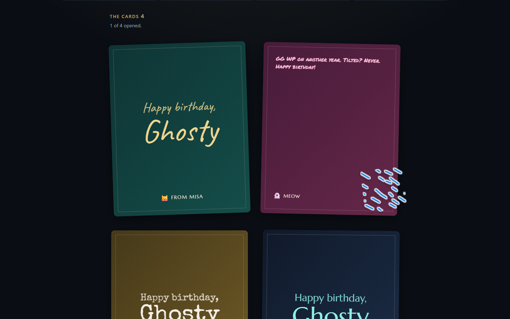

# Ghosty Bingo — a side project with a fixed deadline

A real-time web app for a friend's birthday game night (26 Sep 2026). Friends join one room from a link and mark League of Legends bingo squares live during each match. Each of them also writes a birthday card. At the end, the host publishes a recap that collects the night's moments and the wall of cards.

**Why it's here:** a small product with a hard deadline and one clear success measure: a recap the birthday person wants to keep and share. The PRD shows how the scope was cut around that, including the two features it named as first to cut.

| A match in progress | The recap |
|---|---|
|  |  |

## Product decisions worth noting

- **Two draw pools.** Ghosty plays too, so squares about him never land on his own card. Otherwise they'd be instructions, not predictions.
- **Soft identity on purpose.** Name-only join: impersonation costs a laugh, a login wall costs three friends who never get in.
- **Data, not opinion.** The square text limit started at 90 characters. The built board showed that anything past 40 clips on a 375 px phone, so the limit became 40.
- **Shipped early, then rehearsed.** All must-ship features were live four days ahead of plan, and the biggest remaining risk (real thumbs on real phones) went to a rehearsal.

**Built with:** React, Cloudflare Workers, and one Durable Object per room, so live hit counts stay correct without extra coordination.

## Documents

- [PRD](PRD.md): goals, jobs to be done, core loop, square pool rules, birthday card, recap, scope cut line, schedule, risks
- [Product brief](product-brief.md)
