# IQQ Storage — brand identity proposal

**Client:** Iquique Storage, the logistics company behind [Sistema Gastos](../sistema-gastos/).
**My role:** brand strategy and identity, and the pitch that presented it alongside the digital roadmap.
**Format:** a 21-slide proposal deck in Spanish, presented on 22 Oct 2026. The slides below are from that deck; the pricing slides are left out.

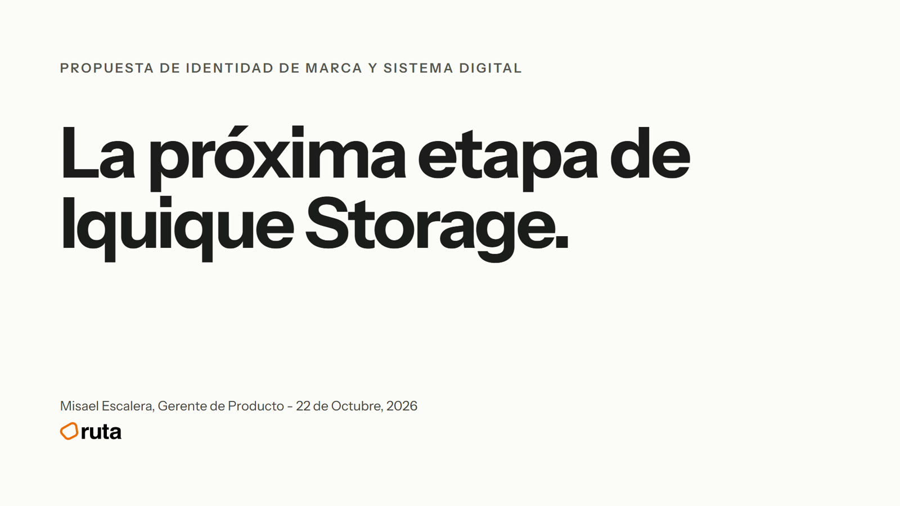

## Why start with the brand

Before building the software (an operations system, a website, a client app and a client portal), the company needed one shared visual language. With the brand defined once, every app is designed from the same rules: less rework, and the products feel like one company.

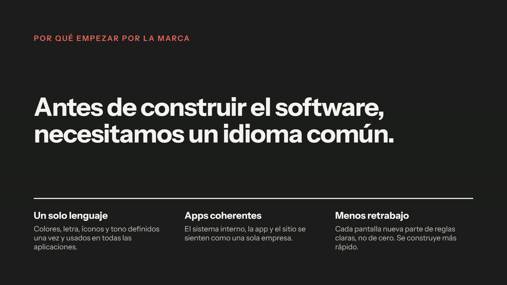

## The brief and the idea

The goal: a brand that looks equally solid on a shipping container, a business card and a screen. The insight that drives every design choice: *clients don't buy square metres, they buy the peace of mind of knowing their cargo is where it should be.* So the brand has to say order, firmness and control.

| The brief | The idea |
|---|---|
| 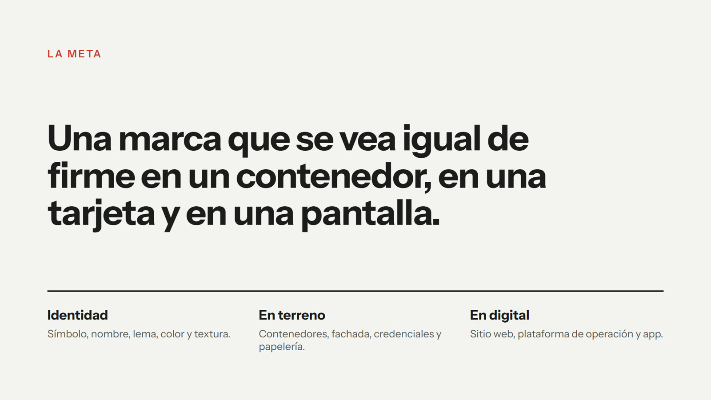 | 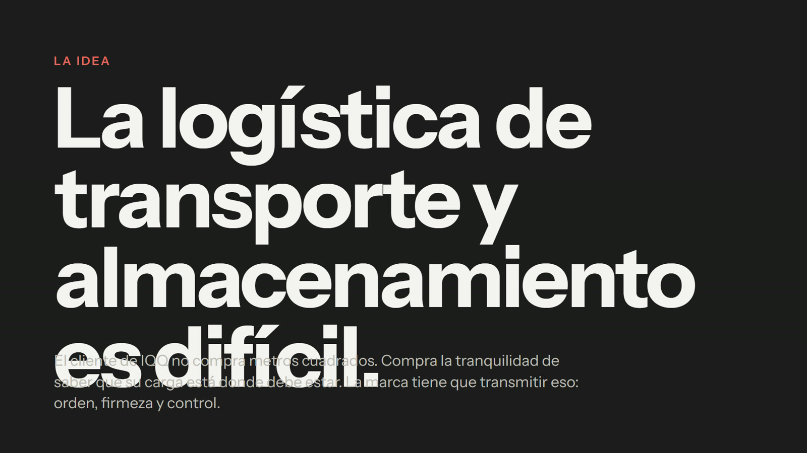 |

## The identity

- **The symbol:** a Q whose ring is the cargo and whose red bar is the waterline, the point where everything is stable. It works alone as an app icon, a stamp or on the side of a container, and was tested down to 16 px.
- **The name:** IQQ, the airport code for Iquique, which people in northern Chile already read as the city. The legal name stays the same.
- **The line:** "WE GOT IT." Short, confident, and understood in any port.
- **Colour and texture:** container red, graphite and sand, with the corrugated steel of a container as the fourth brand element. One typeface: Instrument Sans.

| Symbol | Name and line |
|---|---|
|  | 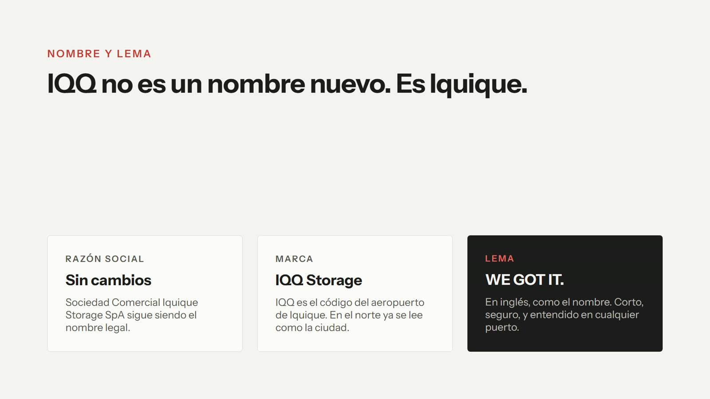 |
| **Colour, texture and type** | **On site** |
| 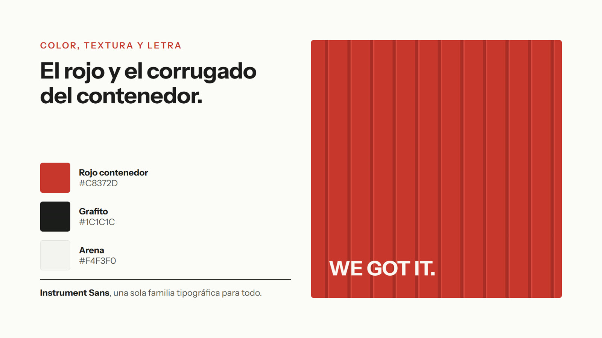 | 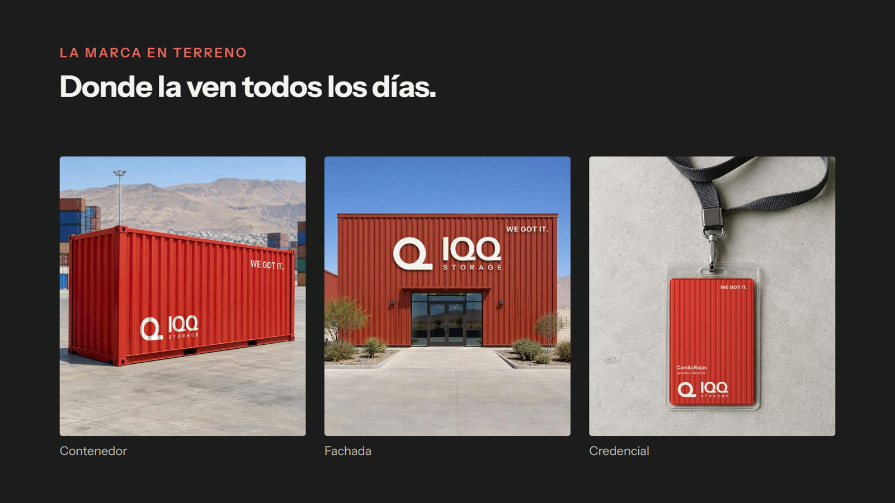 |

## The brand applied

| Stationery | Uniforms and gear |
|---|---|
| 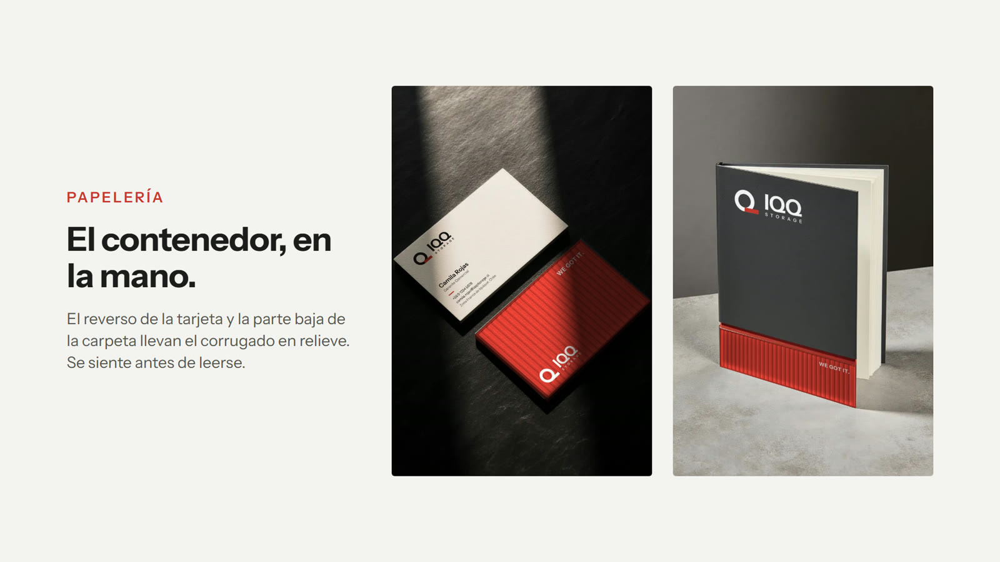 | 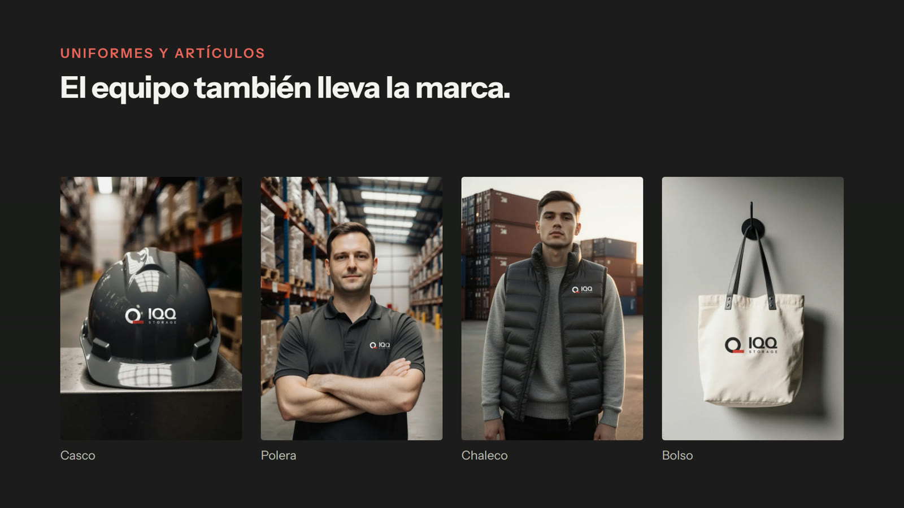 |

| Client app | Operations platform |
|---|---|
| 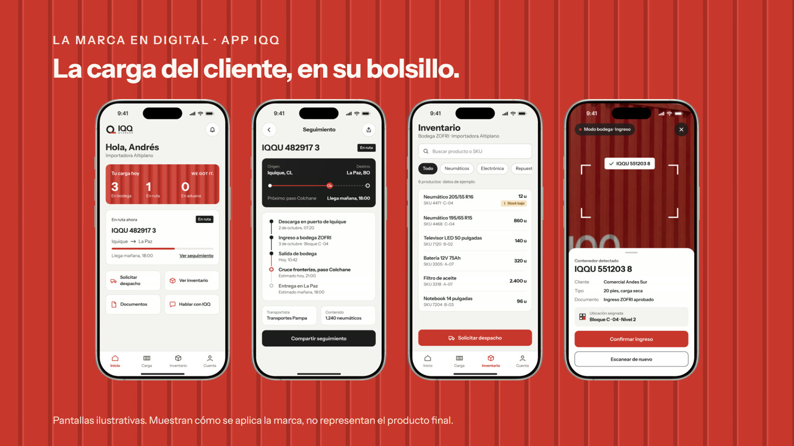 | 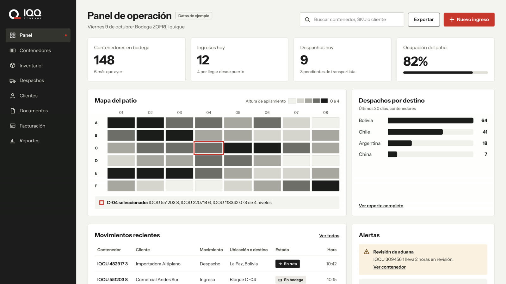 |

| Website | App icon and widget |
|---|---|
| 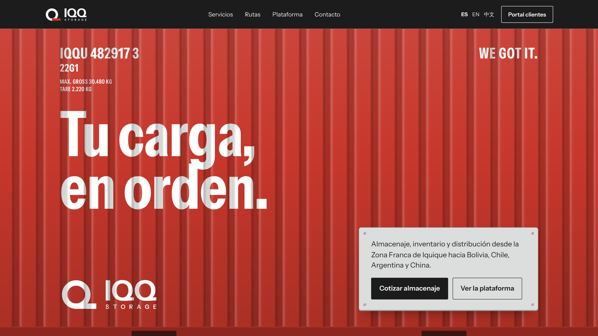 | 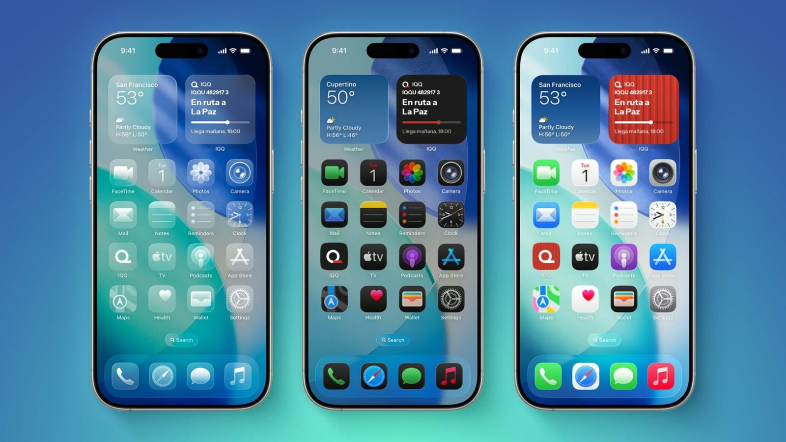 |

*The digital screens in the deck are illustrative: they show how the brand applies, not the final product.*

## Closing the pitch

The deck ends with the five deliverables as one package and a concrete ask: approve the identity, the deliverables and the investment, followed by the next steps.

| Deliverables | The ask and next steps |
|---|---|
| 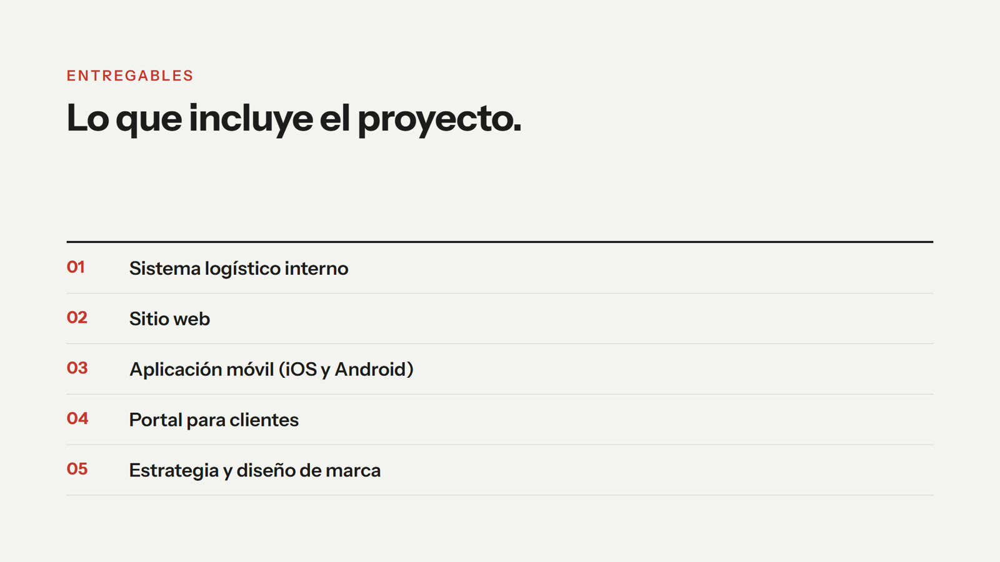 | 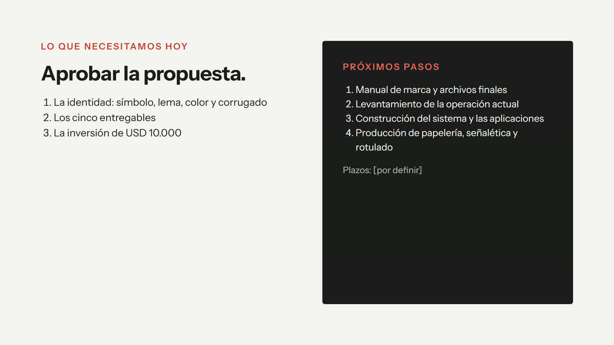 |
