# Paso — client paperwork, step by step

**Customer:** a family import/export business that ran all client paperwork through WhatsApp chats.
**My role:** product definition, spec, naming and brand, design, and building it end to end.
**Status:** live at [holapaso.com](https://holapaso.com) and used by the first customer.

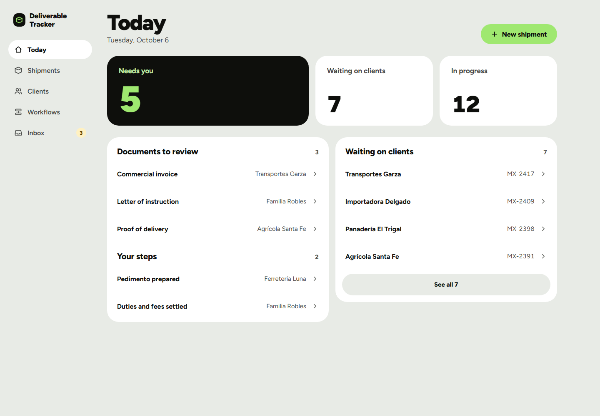

## The problem

From the [PRD](PRD.md), three pains came up again and again:

1. Clients send photos (PNG/JPEG) when the business needs PDFs.
2. Staff tell clients about every status change by phone or text, by hand.
3. Documents and updates get lost in WhatsApp scrollback, and nothing shows where each job stands.

## The product

- Staff build **workflows**: stages that run in order, each holding steps that happen side by side, with forks where an answer decides the path.
- Each client job follows one workflow, so staff and client see the same map.
- Clients act from **one private link with no login**, usually opened from WhatsApp. Photos become PDFs automatically and land on the right step.
- The interface is in English and Spanish. It also has voice messages and a "Listen" button for clients who don't read well.

| Workflows: each one's shape at a glance | The workflow editor |
|---|---|
| 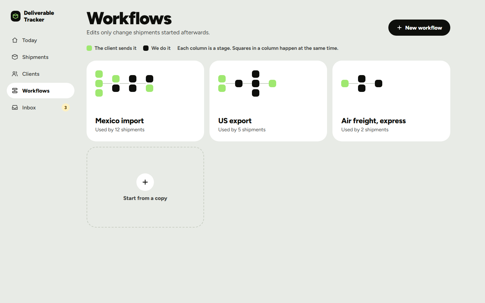 | 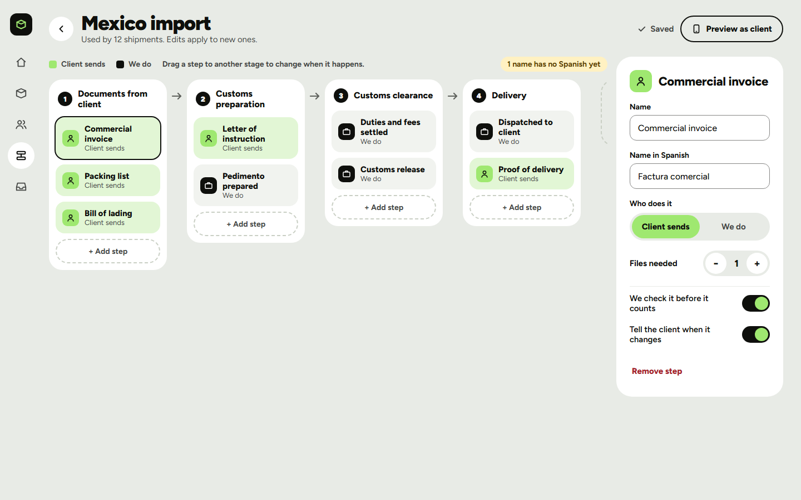 |

| A job, as staff see it | The same job as a live map |
|---|---|
| 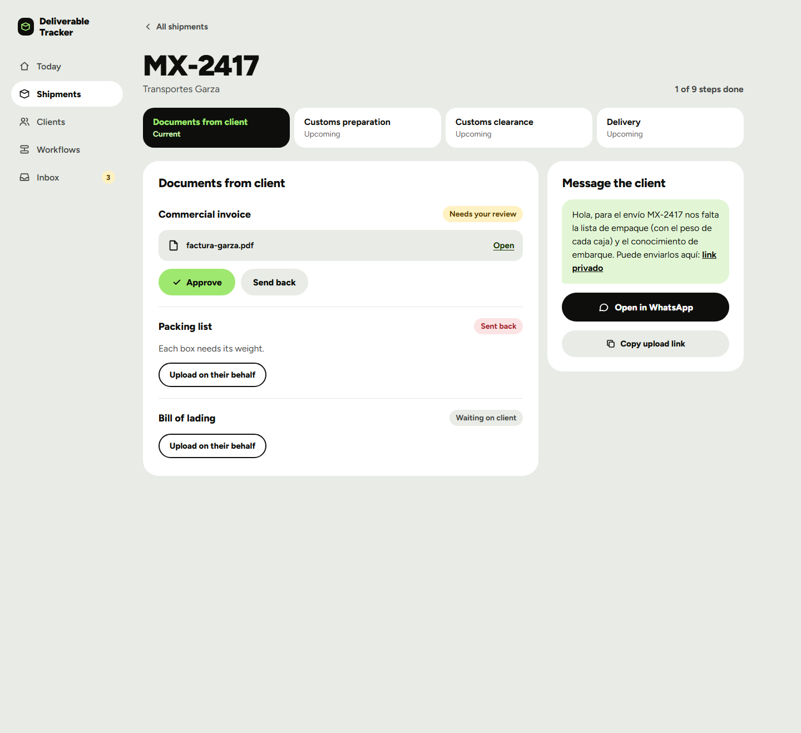 | 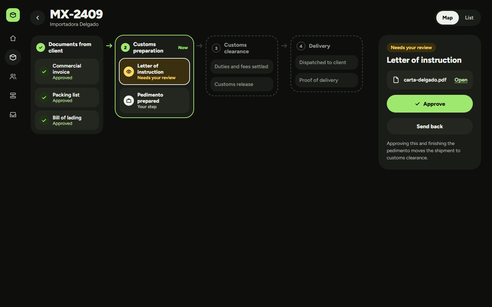 |

| The client's upload link (Spanish) | The client's map of their job |
|---|---|
| 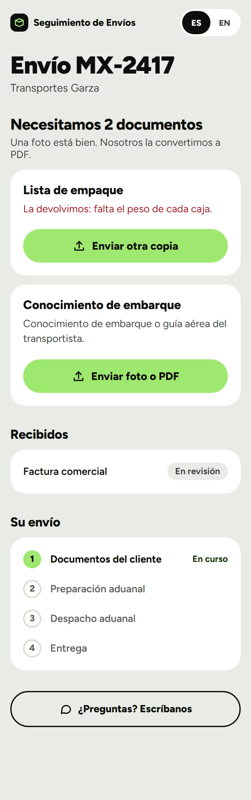 | 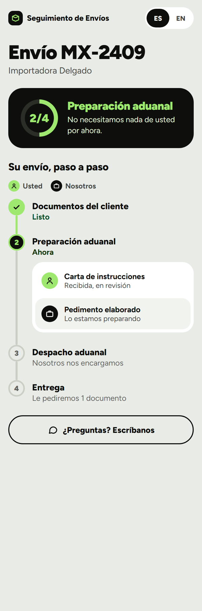 |

*Design boards with sample data. The live app follows this design.*

## Key product decision

The spec planned the **WhatsApp Business Cloud API** from day one. I built it and tested it, but didn't ship it in the first release. Instead, staff sent each client a private link from their own WhatsApp, with the message already written for them.

- **Why:** clients kept the number they already knew. The first release needed no Meta business verification, template approval or provider fees, and family chats on that number never touched the system.
- **Trade-off:** sending a notification took one tap instead of zero, and photos dropped straight into the chat weren't captured automatically.
- **What happened next:** the API code stayed in the repo, so once the product proved its value, automated WhatsApp notifications and reminders were an upgrade, not a rewrite. Today they go out from a consenting staff member's WhatsApp Business number.

## Designing conditional workflows

Real paperwork forks: hazardous cargo needs a permit, motorcycles need different forms than trucks. I explored three ways to add conditions right on the workflow map (a plus on the line, lanes per answer, and answer "wires"), then combined lanes and wires.

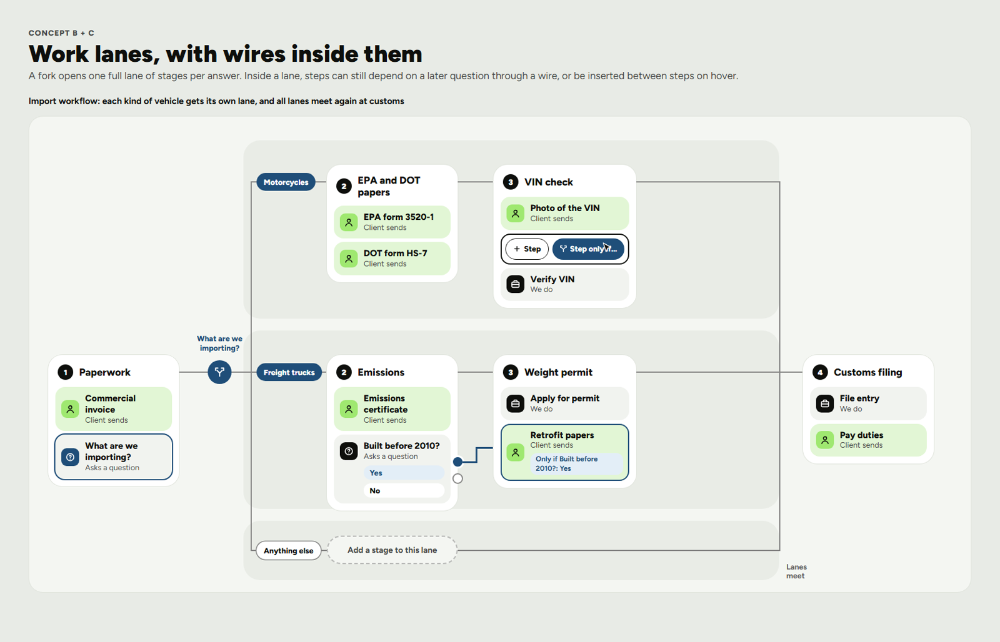

## Naming and brand

I named the product and built its identity. **Paso** means *step* in Spanish, and it is pronounced the same in English. It says what the product does, isn't tied to shipping, fits an app icon, and comes with its own line: *"Paso a paso. Step by step."* The mark is any workflow's map tidied into stairs, and the lime square is always the next step.

| The name, and the alternatives I rejected | Mark and logo |
|---|---|
| 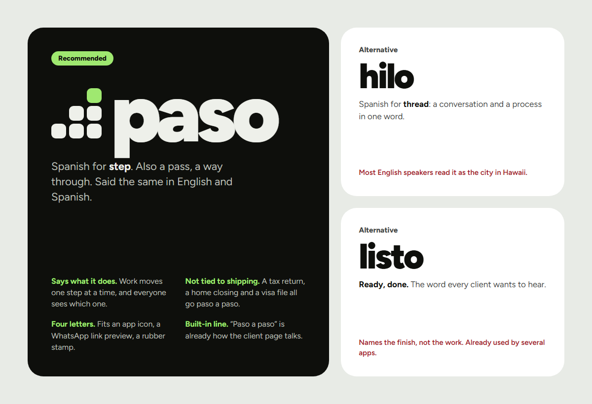 | 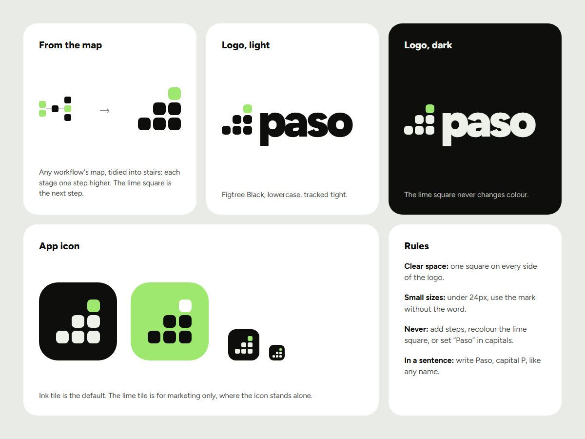 |
| **Colour, type and voice** | **In use, across trades** |
| 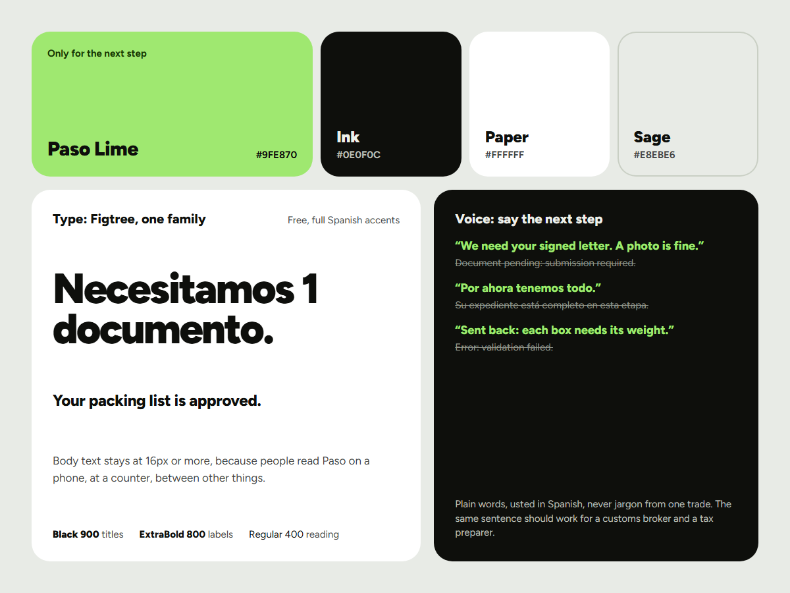 | 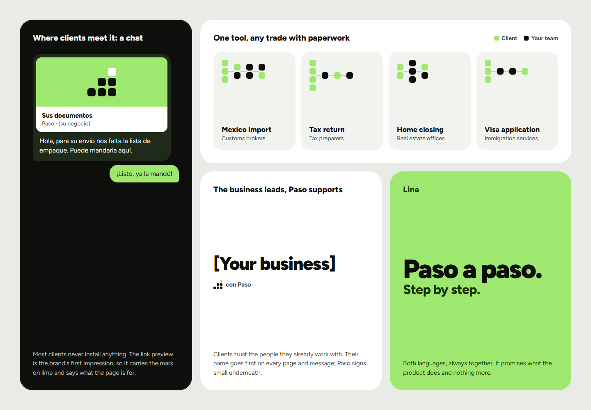 |

## Documents

- [PRD](PRD.md): purpose, users, v1 scope and non-goals, architecture, data model, error handling, testing approach, open items
- [Product brief](product-brief.md): users, positioning, operating context and product principles
- [Go-to-market plan](GTM.md): from one family business to small service teams with client paperwork
