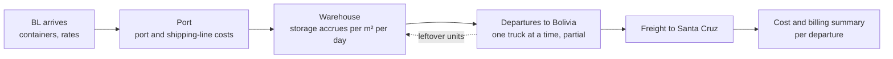
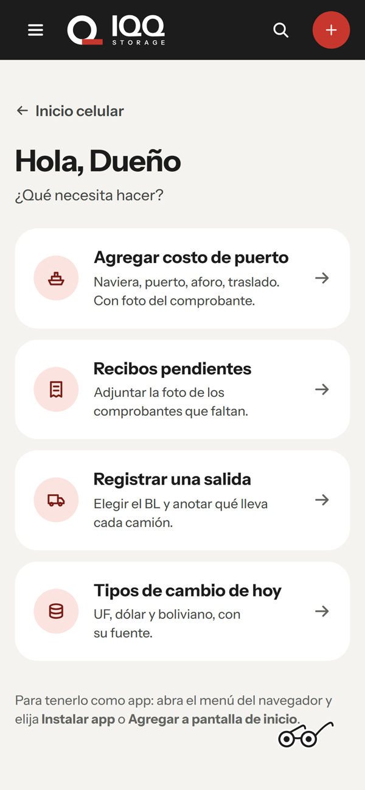
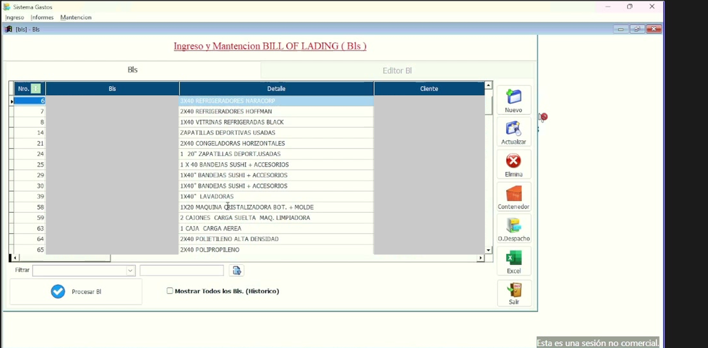
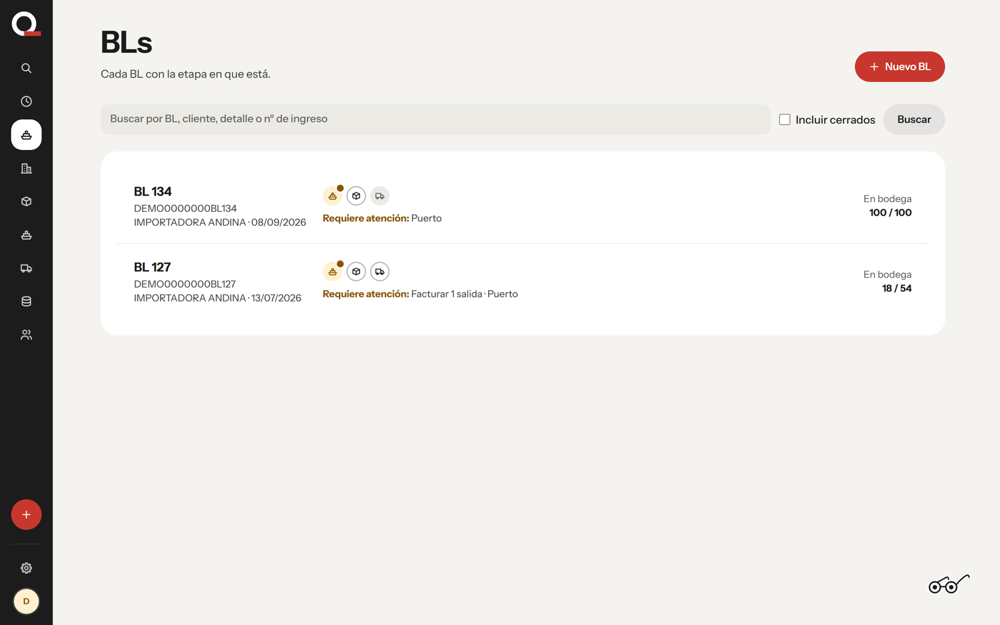
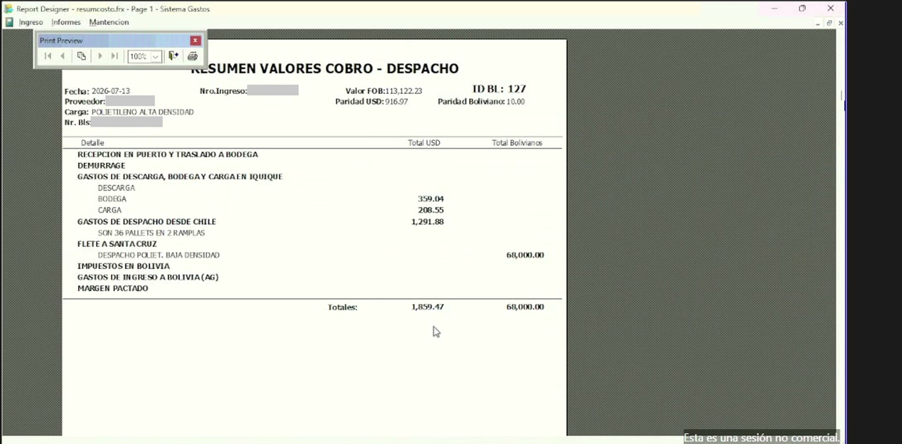

# PRD — Sistema Gastos (redesign)

| | |
|---|---|
| **Status** | Draft v0.2 — 2026-10-22 |
| **Customer** | A logistics company, Iquique (Chile) |
| **Main user interviewed** | The Ops Lead |
| **Sources** | Discovery call 2026-10-15 · [discovery-findings.md](discovery-findings.md) · transcript (`recordings/`, local only — not in the repo) · legacy screenshots (private: they show client data) |

**Implementation:** v0 is built (see the repository README). Phase 2 in §15 lists what it covers.

**Changes in v0.2**
- Hosted **web app** with **mobile modules**.
- **Fractional events** (partial dispatches, fractional quantities, pro-rata costs).
- **Currency rates** pulled automatically by the app (UF, USD, BOB, CLP), with multiple sources per currency.
- **Demo screenshots** added, plus a **legacy → new mapping** for every screen.

Labels used in this document:
- **[Confirmed]**: seen on screen or said on the call. `[mm:ss]` points into the recording.
- **[Assumed]**: our interpretation, still to be validated with the customer.

---

## 1. Summary

The company imports goods into the **ZOFRI free zone in Iquique** for **clients in Bolivia**, stores them in rented warehouses, and ships them by truck to **Santa Cruz**. For every shipment (Bill of Lading, BL) it tracks:
- **costo**: what port, shipping lines, warehouse and trucking charge the company
- **cobro**: what the company charges its client

From these it prints a cost summary and a billing summary. The Owner bills clients from the billing summary.

Today this runs on **Sistema Gastos**, a Visual FoxPro desktop program built by an outside vendor. It is installed on a single laptop that staff reach through AnyDesk.

**This project replaces it with a hosted web app.** It:
- keeps every current calculation
- supports **fractional events** (partial dispatches and leftover balances)
- **fetches currency rates automatically**
- offers **mobile modules** so people can record costs and warehouse activity where they happen (port, warehouse, on the road)


### The shipment, end to end




*v0 home: what needs doing today, goods in the warehouse and the day’s exchange rates.*

*Screenshots of the v0 use the demo data rebuilt from two real shipments. Client, supplier, people and container identifiers are replaced with fake ones; legacy screenshots have them covered.*

---

## 2. Problems to solve

| # | Problem | Evidence |
|---|---|---|
| P1 | **Fractional events are not supported.** When only part of a shipment leaves (a truck fails, weight limits), the leftover units and m² must stay on record and keep accruing storage. The program can't do this. | [Confirmed] `[25:39–27:19]` |
| P2 | **Port costs arrive late.** The port agent sends costs on a spreadsheet ("CF1") only after collecting all receipts. This blocks the final summaries and therefore the dispatch paperwork. | [Confirmed] `[20:24–22:56]` |
| P3 | **Single machine, desktop only.** The program lives on one laptop and is used through AnyDesk. There's no access for the Port Agent, the Customs Coordinator or the Santa Cruz office, no mobile use, and no client view. | [Confirmed] `[18:41–19:22]`, `[30:06–30:11]` |
| P4 | **Currency rates are typed in by hand** for every BL (USD, UF, BOB). The value depends on which source is used, and nothing records which source that was. | [Confirmed] values on screen; sources [Assumed] |
| P5 | **Business risk.** All data is on one laptop, nobody knows how it was installed, and backups are unknown. | [Confirmed] `[23:16–24:04]` |

Data entry itself is **not** a pain point `[25:07–25:12]`. The redesign keeps the current workflow and the cost/cobro layout familiar.

---

## 3. Goals and non-goals

**Goals**
1. Hosted web app reachable from any browser in Chile and Bolivia, with **mobile-friendly modules** for field work.
2. **Every legacy function mapped** to the new version, with nothing lost (§6).
3. Reproduce every current calculation and both summaries exactly (§9).
4. Handle **fractional events**: partial dispatches, decimal quantities, leftover balances that keep accruing storage, and pro-rata cost allocation (§8).
5. **Pull currency rates automatically** (UF, USD, BOB against CLP) from their published sources, with the source and value stored on every record (§10).
6. Import the historical data from the current system.

**Non-goals (for v1)**
- Filing with Aduana, SII or ZOFRI. The current system has none `[24:12–24:25]`. Reading currency rates from public sources is in scope.
- Accounting or invoicing. Billing still happens outside the system from the summary.
- Replacing Dropbox or WhatsApp. The Owner strongly prefers Dropbox `[29:40–30:01]`.
- Native app-store apps. Mobile access is through the responsive web app, installable as a PWA.

---

## 4. Users and roles

| Role | Who | Main device | Needs | Access |
|---|---|---|---|---|
| **Admin / owner** | The Owner | Desktop + phone | View everything, approve, bill clients from the billing summary, manage master data, rates and sources | Full |
| **Operator** | The Ops Lead | Desktop | Create BLs and containers; enter warehouse, unloading, loading, freight; print summaries | Full except admin settings [Assumed] |
| **Port agent** | The Port Agent | **Phone** | Enter port and shipping costs where they happen; photograph receipts | Port reception section only [Assumed] |
| **Warehouse** | Warehouse staff / the Ops Lead | **Phone / tablet** | Record container arrival, unloading/loading hours, partial departures, photos | Warehouse sections only [Assumed] |
| **Customs** | The Customs Coordinator | Desktop + phone | Enter dispatch costs (notary, customs agency, weighing/sealing) | Dispatch costs section only [Assumed] |
| **Santa Cruz office** | Bolivia staff | Desktop + phone | Track arriving shipments; possibly enter Bolivian taxes and costs | [Assumed] — scope to be confirmed |
| **Client** *(phase 2)* | e.g. Client A, Client B | Phone + desktop | Read-only view of their own shipments and billed amounts | Read-only, own data only `[18:58–19:22]` |

---

## 5. Platform: web app and mobile modules

### 5.1 Web app
| ID | Requirement | Pri |
|---|---|---|
| WEB-1 | Hosted web app on its own domain, reachable from current Chrome, Edge, Safari and Firefox. Nothing to install. | M |
| WEB-2 | Responsive layout: full desktop screens for office work; a simplified mobile layout below tablet width | M |
| WEB-3 | Personal logins with roles (§4); sessions work on desktop and phone | M |
| WEB-4 | Several users at once, from Chile and Bolivia, without overwriting each other (record-level locking or change warnings) | M |
| WEB-5 | Daily backups; history of who changed what and when | M |
| WEB-6 | Interface in Spanish; dates as dd/mm/yyyy; number format 1.234,56 or 1,234.56 per user preference [Assumed] | M |

### 5.2 Mobile modules
Mobile screens are **focused task flows**, not shrunken desktop screens. They're installable as a PWA (home-screen icon).

| ID | Module | Who | What it does | Pri |
|---|---|---|---|---|
| MOB-1 | **Port costs** | The Port Agent | Pick a BL → add a cost line (description, issuer, amount, currency) → photograph the receipt now or later. Replaces the CF1 spreadsheet (P2). | **M** |
| MOB-2 | **Receipt capture** | The Port Agent, the Customs Coordinator | Attach photo/PDF receipts to existing cost lines; list of lines still waiting for a receipt | M |
| MOB-3 | **Warehouse activity** | Warehouse | Record a container's arrival (start of storage), forklift hours, support staff and truck parking, with photos | S |
| MOB-4 | **Partial departure** | Warehouse / the Ops Lead | Record which containers and how many units leave on each truck. The remaining balance updates immediately (§8). | S |
| MOB-5 | **Dashboard** | The Owner | Open BLs, goods in the warehouse and days stored, storage accruing on leftovers, summaries ready to bill | S |
| MOB-6 | **Summaries** | The Owner, the Customs Coordinator | View and share (PDF) the cost and billing summary of a dispatch | M |
| MOB-7 | **Today's rates** | All | Current UF, USD and BOB from each source (§10) | S |
| MOB-8 | **Client tracking** *(phase 2)* | Clients | Status of their shipments, balances in the warehouse, summaries | C |
| MOB-9 | **Weak signal** | The Port Agent, warehouse | Save entries on the phone when the signal is poor and upload them later | C |

<p float="left"> </p>

*v0 mobile modules: home and the port-cost form that replaces the CF1 spreadsheet (MOB-1).*

---

## 6. Legacy → new mapping

Every screen seen in the demo, what it does today, and where it goes in the new version. Screens not shown in the demo are listed in §6.12.

### Summary

| # | Legacy screen (FoxPro form) | New module | Requirements | Change |
|---|---|---|---|---|
| 6.1 | Main menu: Ingreso / Informes / Mantención | App navigation + Master data | MD-1…MD-5 | Same areas; web navigation |
| 6.2 | BL list (`bls`) | BLs → List | BL-1, BL-4 | + search, status filters, mobile list |
| 6.3 | Create/update BL (`blsingreso`) | BLs → BL form | BL-2, BL-3, CR-5 | Rates pre-filled from sources (§10) |
| 6.4 | Containers (`blsingreso1`) | BLs → Containers | CT-1…CT-4 | + m² per container, decimal quantities |
| 6.5 | BL editor (`bls`, Editor BL tab) | BL detail page | — | Same 8 sections + live balances |
| 6.6 | Port reception (`recepcion`) | Port costs | PR-1…PR-5, MOB-1, MOB-2 | **The Port Agent enters directly on mobile** |
| 6.7 | Warehouse storage (`bodega2`, `bodega2ing`) | Warehouse → Storage | WS-1…WS-4, FR-1…FR-4 | **Leftover balances keep accruing** |
| 6.8 | Unloading (`bodega3`) | Warehouse → Unloading | WL-1, WL-3, MOB-3 | Decimal hours; UF from source |
| 6.9 | Loading (`bodega4`) | Warehouse → Loading | WL-2, WL-3, MOB-3, MOB-4 | Linked to each partial departure |
| 6.10 | Dispatch costs (`gdespach1`) | Dispatches → Costs | DS-1…DS-3, FR-5 | Several dispatches per BL |
| 6.11 | Freight Santa Cruz (`fletes`, `fleingreso`) | Dispatches → Freight | FB-1, CR-5 | BOB rate from chosen source |
| 6.13 | Print summaries (`blsingreso3`, `resumcosto.frx`) | Reports | RP-1…RP-4, MOB-6 | PDF, web, mobile share |

### 6.1 Main menu and splash
- **Today:** Ingreso (clientes, proveedores, centro de costo, Bill of Lading) · Informes · Mantención `[00:12]`. Built by the original vendor.
- **New:** sidebar navigation (desktop) or bottom bar (mobile): *BLs · Bodega · Despachos · Reportes · Tipos de cambio · Mantención*.

### 6.2 BL list — `bls`

| Legacy | v0 |
|---|---|
|  |  |
- **Today:** grid of open BLs (Nro., BL, Detalle, Cliente, Nro. Ingreso, Fecha); filter; "Mostrar todos (histórico)"; buttons Nuevo, Actualizar, Elimina, Contenedor, O.Despacho, Excel, Procesar BL.
- **New:** searchable list with status chips (*En bodega*, *Parcialmente despachado*, *Despachado*, *Cerrado*); Excel export; tap to open the BL.

### 6.3 Create/update BL — `blsingreso`
- **Today:** client, BL number, detail, ZOFRI entry number, date, USD rate (925.25), BOB rate (11.00), supplier, vessel, cargo, CIF value, "BL terminado" flag. Per-BL rates for storage USD/day, unloading UF value and price, ramp-truck and trailer-truck parking, each as cost and cobro `[00:52–04:56]`.
- **New:** the same fields. Currency fields are **pre-filled from the chosen rate source** with the date and source shown, and can be overridden (§10). Default storage, UF and parking prices come from Mantención.

### 6.4 Containers — `blsingreso1`
- **Today:** container, unit (SACO), quantity received, balance (saldo), margin (USD 1,000) `[05:06–06:10]`.
- **New:** the same, plus **m² per container**, **decimal quantities**, and a balance updated automatically by each partial departure (§8).

### 6.5 BL editor (process BL)

| Legacy | v0 |
|---|---|
|  |  |
- **Today:** BL header plus 8 section buttons (Recepción puerto, Bodega/descarga/carga, Gastos despacho, Demurrage, Fletes Santa Cruz, Impuestos Bolivia, Gastos ingreso Bolivia, Kardex contenedor) and 2 print buttons.
- **New:** a BL detail page with the same 8 sections as tabs, a **balance panel** (units and m² still in the warehouse per container), and the list of dispatch operations with their summaries.

### 6.6 Port reception — `recepcion`
- **Today:** cost lines (date, receipt, description, issuer, total CLP, total USD, notes), entered by the Ops Lead from the Port Agent's CF1 spreadsheet `[06:25–09:09]`, `[20:24–22:56]`.
- **New:** **The Port Agent enters lines directly from a phone (MOB-1)** as costs happen; receipts attached later (MOB-2); amounts in USD or CLP converted at the BL's rate. Optional CF1 import during the transition.

### 6.7 Warehouse storage — `bodega2` / `bodega2ing`
- **Today:** per container and dispatch operation: start and end date, days, m², quantity deducted, cost and cobro (m² × days × USD/day) `[09:43–11:11]`.
- **New:** the same calculation, plus **fractional storage**: when part of a container leaves, the remaining units and their share of the m² keep accruing until the next departure (§8). Storage for goods still in the warehouse is shown as accruing to today.

### 6.8 Unloading — `bodega3`
- **Today:** per container: forklift hours, external forklift, support staff, each with a rate; separate cost and cobro tables. Forklift rate = UF value × UF price `[11:30–13:16]`.
- **New:** the same; **decimal hours** (e.g. 1.5); UF value taken from the rate source for the unloading date (§10); recordable from mobile (MOB-3).

### 6.9 Loading — `bodega4`
- **Today:** the same as unloading, plus truck parking (machines, days, price), per container and dispatch operation `[15:09–15:31]`.
- **New:** each loading record is linked to a **partial departure** (MOB-4), so loading, storage end date and balances update together.

### 6.10 Dispatch costs — `gdespach1`


- **Today:** dispatch operations per BL (date, type, detail, CIF value, transferred value, provisioned cobro, total USD). A partial dispatch moved 75,982.50 of 113,122.23 CIF `[15:36–16:42]`.
- **New:** a BL has **any number of dispatch operations**. Each one records containers and units leaving, transferred value, and the Customs Coordinator's costs. Each dispatch gets its own summaries (§8, §11).

### 6.11 Freight to Santa Cruz — `fletes` / `fleingreso`
- **Today:** per dispatch operation: trucks with trailer and ramp trucks × agreed price in BOB = total BOB; USD at the BOB rate `[17:06–17:36]`. The rate field is labelled "Paridad Dólar" even though it holds the BOB rate.
- **New:** the same, with the BOB rate taken from a chosen source (agreed, BCB official, or market — §10) and labelled correctly.

### 6.12 Not shown in the demo (must be mapped later)
Demurrage · Impuestos pagados en Bolivia · Gastos de ingreso en Bolivia · Kardex movimiento contenedor · O.Despacho button · Informes menu · Mantención menu · Clientes / Proveedores / Centro de costo. These are in scope; their fields come from a follow-up demo or the legacy data (Q4, Q5).

### 6.13 Summaries — `blsingreso3`, `resumcosto.frx`

| Legacy billing summary | v0 billing |
|---|---|
|  |  |

Same BL, same totals: 1,859.47 billing and 1,643.21 cost.
- **Today:** choose a dispatch operation → print the cost summary or billing summary (sections in USD, freight in BOB, totals) `[17:38–18:36]`.
- **New:** the same layout (§11), viewable on web and mobile, exported to PDF, one per dispatch operation. Rates and sources are printed in the header.

---

## 7. Functional requirements

Priority: **M** = must have for v1 · **S** = should have · **C** = could have / phase 2

### 7.1 Master data
| ID | Requirement | Pri |
|---|---|---|
| MD-1 | Manage clients (Bolivian importers) | M |
| MD-2 | Manage foreign suppliers | M |
| MD-3 | Manage cost centres `[00:12]` (purpose unknown, Q5) | S |
| MD-4 | Default rates and prices (storage USD/day, UF price, parking, tramitación fee) used to pre-fill new BLs; editable per BL | M |
| MD-5 | Manage currency sources and the default rate type for each use (§10) | M |

### 7.2 Bill of Lading
| ID | Requirement | Pri |
|---|---|---|
| BL-1 | List BLs with search, status filter and history toggle | M |
| BL-2 | Create and edit a BL with all legacy fields (§6.3) | M |
| BL-3 | Per-BL cost and cobro rates for storage, unloading (UF price) and parking | M |
| BL-4 | Excel export of lists | S |
| BL-5 | Delete with confirmation; audit trail | M |

### 7.3 Containers
| ID | Requirement | Pri |
|---|---|---|
| CT-1 | Containers per BL: number, unit, quantity received, margin USD | M |
| CT-2 | Balance per container = received − dispatched (decimals allowed) | M |
| CT-3 | m² occupied per container | M |
| CT-4 | Once added, containers are available in every later section | M |

### 7.4 Port reception
| ID | Requirement | Pri |
|---|---|---|
| PR-1 | Cost lines: date, receipt reference, description, issuer, amount, currency, notes | M |
| PR-2 | Enter in USD or CLP; convert at the BL's USD rate | M |
| PR-3 | The Port Agent enters lines directly (web or MOB-1); receipts attached later; "receipt pending" flag | M |
| PR-4 | Tramitación fee (CLP 100,000 per container) added automatically, editable `[08:47–09:05]` | S |
| PR-5 | Import the CF1 spreadsheet during the transition | C |

### 7.5 Warehouse
| ID | Requirement | Pri |
|---|---|---|
| WS-1 | Storage records per container and dispatch operation: start, end, days, m², quantity, cost, cobro | M |
| WS-2 | Calculate as in §9 R2–R3 | M |
| WS-3 | Storage for goods still in the warehouse accrues to today or a planned end date | M |
| WS-4 | Leftover balances keep accruing after a partial dispatch (§8) | **M** |
| WL-1 | Unloading per container: forklift, external forklift, support staff; cost and cobro | M |
| WL-2 | Loading per container and dispatch: same fields plus truck parking | M |
| WL-3 | Forklift rate = UF value × UF price, UF taken from the rate source (§10) | M |

### 7.6 Dispatches, freight and Bolivia
| ID | Requirement | Pri |
|---|---|---|
| DS-1 | Any number of dispatch operations per BL (full or partial) | M |
| DS-2 | Each operation records containers and units leaving and the transferred value against the CIF value | M |
| DS-3 | Dispatch costs (the Customs Coordinator), passed through at cost | M |
| FB-1 | Freight per dispatch: trucks × agreed BOB price; USD at the chosen BOB rate | M |
| FB-2…5 | Bolivian taxes, Bolivian entry costs, demurrage, container log — fields to be confirmed (§6.12) | M/S |

### 7.7 Reports
| ID | Requirement | Pri |
|---|---|---|
| RP-1 | Cost summary per BL and dispatch operation, same layout as today (§11) | M |
| RP-2 | Billing summary per BL and dispatch operation, including "Margen pactado" | M |
| RP-3 | PDF export; share from mobile | M |
| RP-4 | Per-section printouts | S |

---

## 8. Fractional events

A **fractional event** is anything that splits a BL, a container or a cost into parts. The legacy system only partly handles these, and the call named this as the main functional gap `[25:39–27:19]`.

### 8.1 Cases to support
| Case | Example | Today |
|---|---|---|
| **Partial dispatch** | 5 containers × 20 sacks = 100 sacks; 4 trucks take 98, and 2 sacks stay | Not supported `[26:25–27:09]` |
| **Several dispatches per BL** | BL 127: 3 containers arrived, 2 dispatched first `[16:01–16:04]` | Partly (dispatch operations exist) |
| **Partial container** | Part of one container's sacks leaves on one truck, the rest on another | Not supported |
| **Decimal quantities** | 1.5 forklift hours; 11.84 m²; 0.5 pallet | Hours and m² yes; units [Assumed] |
| **Storage across part of a period** | Leftover 2 sacks stored from 26 Aug until a later truck | Not supported |
| **Partial CIF value** | Dispatch transfers 75,982.50 of 113,122.23 CIF (67.2 %) | Yes (manual) |

### 8.2 Requirements
| ID | Requirement | Pri |
|---|---|---|
| FR-1 | A dispatch operation records **per container** the quantity leaving (decimals allowed). It can't exceed the current balance. | M |
| FR-2 | Container balance and **remaining m²** update immediately: remaining m² = m² × balance ÷ quantity received [Assumed rule — confirm, Q13] | M |
| FR-3 | Storage is billed **per departure**, with the method selectable (Q13): **per unit** — each unit pays from arrival until it leaves (v0 default; matches the legacy BL 127 printout) — or **per period** — each departure pays for all space occupied since the previous departure. Both bill the same total m² × days; they differ only in which dispatch carries it. Leftovers keep accruing at the BL's rate. | M |
| FR-4 | Show **storage accruing to today** on leftovers, per container and per BL | M |
| FR-5 | **Allocate BL-level costs to dispatch operations**: port costs, unloading, margin, tramitación. Allocation method selectable per BL: by units, by m², by CIF value, or 100 % to one dispatch. The default is to be agreed (Q14). | M |
| FR-6 | Each dispatch operation has its **own cost and billing summary**; the BL total = sum of its dispatches plus leftovers still in storage | M |
| FR-7 | Closing a BL is only allowed when every container balance is zero, or after an explicit write-off with a reason | S |
| FR-8 | Rounding: amounts to 2 decimals per line; totals = sum of rounded lines, so summaries match line by line [Assumed — check against legacy] | M |

### 8.3 Worked example
Container HAMU111603-1: 20 sacks, 11.84 m², storage cobro 0.40 USD/day, in the warehouse from 15/09.

Dispatch #1 on 30/10 takes 18 sacks; dispatch #2 on 20/11 takes the last 2. Days count both ends (R3).

| | Billed on dispatch #1 | Billed on dispatch #2 |
|---|---|---|
| **Per unit** (v0 default) | 18 sacks · 10.656 m² · 15/09–30/10 (46 days) = **USD 196.07** | 2 sacks · 1.184 m² · 15/09–20/11 (67 days) = **USD 31.73** |
| **Per period** | all 20 sacks · 11.84 m² · 15/09–30/10 (46 days) = **USD 217.86** | 2 sacks · 1.184 m² · 31/10–20/11 (21 days) = **USD 9.95** |

Both methods bill the same space × time (569.5 m²·days in total). The automated tests check both methods and that the totals match.

---

## 9. Business rules and calculations

All rules were checked against numbers on screen (details in [discovery-findings.md §4](discovery-findings.md)).

| ID | Rule |
|---|---|
| R1 | **USD ↔ CLP** uses the BL's USD rate. Example: 686,000 CLP ÷ 925.25 = 741.42 USD |
| R2 | **Storage (USD)** = m² × days × USD/day (cost or cobro rate). Example: 11.84 × 31 × 0.23 = 84.42; × 0.40 = 146.82 |
| R3 | **Storage days** = end − start **+ 1** (both days count). Example: 15/09 → 15/10 = 31 |
| R4 | **Forklift rate (CLP/h)** = UF value × UF price (cost 0.35, cobro 0.50). Example: 40,844.79 × 0.35 = 14,296 |
| R5 | **Unloading/loading total** = Σ (hours or units × rate) + parking (loading only) |
| R6 | **Freight** = trucks × agreed BOB price; USD = BOB ÷ BOB rate. Example: 2 × 34,000 = 68,000 BOB → 6,800 USD |
| R7 | **Summaries:** CLP sections → USD at the BL's USD rate; BOB freight in its own column; total = sum of sections |
| R8 | **Margins:** client margin per container (USD) + tramitación fee per container (CLP 100,000) |
| R9 | **Dispatch costs** are passed through (same in cost and cobro) |
| R10 | **Fractional events** follow §8 (FR-2, FR-3, FR-5) |

---

## 10. Currencies and exchange rates


### 10.1 What the legacy system does
Each BL holds rates typed in by hand: **USD/CLP** (925.25, 916.97), **UF value** (40,844.79, 40,820.31) and **USD/BOB** (10.00, 11.00) [Confirmed, screens]. The Ops Lead calls the USD rate the **"dólar aduanero"**, fixed for the whole month `[02:44–02:54]`, `[07:31–07:56]`. The BOB rate is "a reference" for freight agreed in bolivianos `[27:50–28:30]`. Nothing records which source a rate came from.

### 10.2 Currencies and rate types
**The app pulls rates automatically from their published sources.** Nobody types them in. The PRD doesn't track the values themselves, only where they come from and how often they're published.

Values **differ depending on the source**, so the system stores rates by **type and source**, not as one number per currency.

| Currency pair | Rate types to pull | Source to pull from | Pull frequency |
|---|---|---|---|
| **UF → CLP** | UF (official) | Banco Central de Chile (directly or via an aggregator such as mindicador.cl) | Daily; values are published ahead for the coming month |
| **USD → CLP** | Dólar observado | Banco Central de Chile | Daily (business days) |
| **USD → CLP** | **Dólar aduanero / monthly rate** used today | To confirm (Q15): Banco Central's monthly rate or an Aduana publication | Monthly |
| **USD → BOB** | **BCB official rate** (published daily) | Banco Central de Bolivia (bcb.gob.bo) | Daily |
| **USD → BOB** | Market / parallel rate | Market sources; vary by provider [Assumed] | Daily |
| **USD → BOB** | **Agreed rate** for a freight contract | Entered by the user (the only rate not pulled) | Per contract or dispatch |
| CLP | Base currency for Chilean costs | — | — |

*Rates are pulled when each source publishes them, not live by the second. Sources must be confirmed with the customer and tested before go-live.*

### 10.3 Requirements
| ID | Requirement | Pri |
|---|---|---|
| CR-1 | **Rate registry:** each rate type has a currency pair, source, URL/API, publishing frequency and an active/inactive switch | M |
| CR-2 | **Automatic pull (core feature):** a scheduled job pulls new values from every active source on its publishing schedule (daily, or monthly for monthly rates), retries on failure, and keeps the full history. New BLs and cost lines use the pulled values with no manual entry. | **M** |
| CR-3 | **Manual entry and override:** admins can enter or correct a value. The user, time and reason are recorded. | M |
| CR-4 | **Source comparison:** when a rate is chosen, show the same day's values from the other sources, with a warning if they differ by more than a set % | S |
| CR-5 | **Default per use:** admin chooses which rate type applies where (e.g. USD for port costs = dólar aduanero; UF for forklift = UF of the unloading date; BOB for freight = agreed, falling back to BCB official). Per BL or line, users can switch type or override. | M |
| CR-6 | **Snapshot on every amount:** each converted amount stores value, rate type, source, rate date and fetch time. Later rate updates **never change saved amounts or printed summaries**. | M |
| CR-7 | **Explicit re-rate:** a "recalculate with today's rate" action, with preview, confirmation and audit, for records not yet billed | S |
| CR-8 | **Stale or failed source alerts:** warn admins when a source hasn't updated as expected; block automatic use of a rate older than its frequency allows | M |
| CR-9 | **Rates screen:** today's values and history per type and source, on web and mobile (MOB-7) | S |
| CR-10 | **Summaries print** the rate type, source and date used for each currency in the header | M |

---

## 11. Report layout (both summaries)

Header: date · supplier · cargo · BL number · ZOFRI entry number · FOB/CIF value · dispatch operation · USD rate (type, source, date) · BOB rate (type, source, date) · BL ID

| Section | Lines | Columns |
|---|---|---|
| Recepción en puerto y traslado a bodega | (allocated share, §8 FR-5) | USD |
| Demurrage | | USD |
| Gastos de descarga, bodega y carga en Iquique | Descarga · Bodega · Carga | USD |
| Gastos de despacho desde Chile | operation note (e.g. "36 pallets in 2 ramp trucks") | USD |
| Flete a Santa Cruz | operation description | BOB |
| Impuestos en Bolivia | | USD |
| Gastos de ingreso a Bolivia (AG) | | USD |
| Margen pactado *(billing only)* | | USD |
| **Totales** | | USD · BOB |

---

## 12. Data model (draft)

```
Client 1─* BL *─1 Supplier
BL 1─* Container
BL 1─* DispatchOperation
DispatchOperation 1─* DispatchLine (container, quantity)      ← fractional events
Container 1─* StoragePeriod (start, end, units, m², rate snapshot)
BL 1─* PortCost (receipt status, attachments)
Container ─ Unloading lines (cost/cobro)
DispatchLine ─ Loading lines (cost/cobro + parking)
DispatchOperation 1─* DispatchCost · Freight
BL 1─* BoliviaTax / BoliviaEntryCost / Demurrage / ContainerMovement
CostAllocation (BL-level cost → dispatch operation, method, share)
RateSource 1─* RateType 1─* RateValue (date, value, fetched_at, manual?)
MoneyAmount (amount, currency, rate_value_id, converted amounts)   ← snapshot
User ─ Role ─ (optional) Client
Attachment ─* any cost line
AuditLog
```

---

## 13. Non-functional requirements

| Area | Requirement |
|---|---|
| Hosting | Managed cloud hosting with HTTPS, daily backups and point-in-time restore |
| Devices | Desktop browsers for office work; phones and tablets for mobile modules (§5.2) |
| Performance | Lists and BL detail load in under 2 s on a 4G connection |
| Security | Personal logins and roles; clients see only their own data; full audit log |
| Data integrity | Saved amounts never change when rates update (CR-6); every change audited |
| Familiarity | Keep the legacy section names and the cost/cobro side-by-side layout |
| Branding | Company corporate identity; the redesign proposal comes first (§15) |
| Migration | Import every BL, container, cost and rate from the legacy FoxPro `.dbf` data; imported summaries must match legacy printouts |
| Exports | Excel for lists; PDF for summaries |
| Integrations | Read-only rate sources (§10); optional Dropbox storage for receipts (phase 2) |

---

## 14. Open questions

| # | Question | Ask |
|---|---|---|
| Q1 | Loading parking shows 4 days × 45,000 but totals 45,000. Is the price per day or per stay? | The Ops Lead |
| Q2 | When is "Margen pactado" filled in on the billing summary? It was blank for BL 127 although its containers have margins. | The Ops Lead / the Owner |
| Q3 | Dispatch costs show the same figure under "Total $" and "Total USD". Are they entered in USD only? | The Ops Lead |
| Q4 | Which fields do Demurrage, Bolivian taxes, Bolivian entry costs and the container log have? | The Ops Lead |
| Q5 | What is in the Informes and Mantención menus, and what are cost centres used for? | The Ops Lead |
| Q6 | What exactly does the Santa Cruz office do in the system? | The Owner |
| Q7 | Who owns the source code: the company or the original vendor? Can the original vendor provide it? | The Owner |
| Q8 | How was it installed, and are there backups? | The Owner |
| Q9 | Can we get a copy of the program folder and `.dbf` data for migration? | The Owner |
| Q10 | What does the Port Agent's CF1 spreadsheet contain? Get a sample. | The Ops Lead / the Port Agent |
| Q11 | Should clients see costs or only cobro amounts? | The Owner |
| Q12 | How many BLs and users per month? | The Owner |
| Q13 | After a partial dispatch, is leftover m² proportional to units left, or measured again? | The Ops Lead |
| Q14 | How should BL-level costs (port, unloading, margin) be split across dispatches: units, m², CIF value, or all on the first? | The Owner |
| Q15 | Where exactly does the monthly "dólar aduanero" come from? | The Ops Lead / the Customs Coordinator |
| Q16 | Which BOB rate do they use: BCB official, market, or the rate agreed with the trucker? Is it the same for cost and billing? | The Owner |
| Q17 | Which UF value applies: the BL date, the unloading date, or the dispatch date? | The Ops Lead |
| Q18 | Which mobile tasks matter most, and do the port and warehouse have reliable signal? | The Ops Lead / the Port Agent |
| Q19 | The legacy list's "Nro." column doesn't match the BL ID (Nro. 120 = ID 134). What is it? | The Ops Lead |
| Q20 | Are port costs billed to the client at cost, or are some excluded or marked up? | The Owner |

The call script that closes these questions while presenting v0 is [validation-call-script.md](validation-call-script.md).

---

## 15. Plan

| Phase | Content | Exit criteria |
|---|---|---|
| 0. Discovery | Demo call (done 2026-10-15); get program files and data; answer §14 | Q1–Q10, Q13–Q17 answered; data copy in hand |
| 1. Identity + redesign proposal | Corporate identity and mock screens (desktop + mobile) | Direction approved by the Owner |
| 2. Prototype — **v0 built** | Working web app (not just clickable): BLs, containers, port costs, storage, unloading, loading, partial dispatches, freight, both summaries, automatic rate pulls, mobile port costs and receipts, demo roles. Open questions are settings in Mantención. BL 127 summaries reproduce the legacy printouts to the cent (automated tests). | The Ops Lead can walk through one real BL with a partial dispatch |
| 3. MVP | All "M" requirements; data migration; rate fetching; roles for the Ops Lead, the Port Agent, the Customs Coordinator | Summaries for 5 historical BLs match the legacy printouts to the cent |
| 4. Phase 2 | Client portal, CF1 import, Dropbox receipt storage, offline mobile | — |

## 16. Success measures
- Cost and billing summaries match the legacy system for every migrated BL.
- Every legacy screen in §6 has a working equivalent before the old system is switched off.
- The Port Agent records port costs from a phone within [N] days of incurring them. Target to be agreed.
- Partial dispatches are recorded without workarounds, and storage on leftovers is billed.
- No rate is typed in by hand unless overridden on purpose. Every amount shows its rate source.
- Staff in Iquique and Santa Cruz work without AnyDesk.
