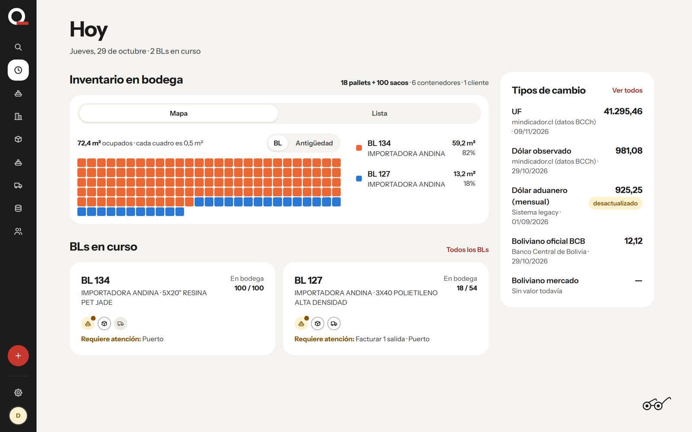
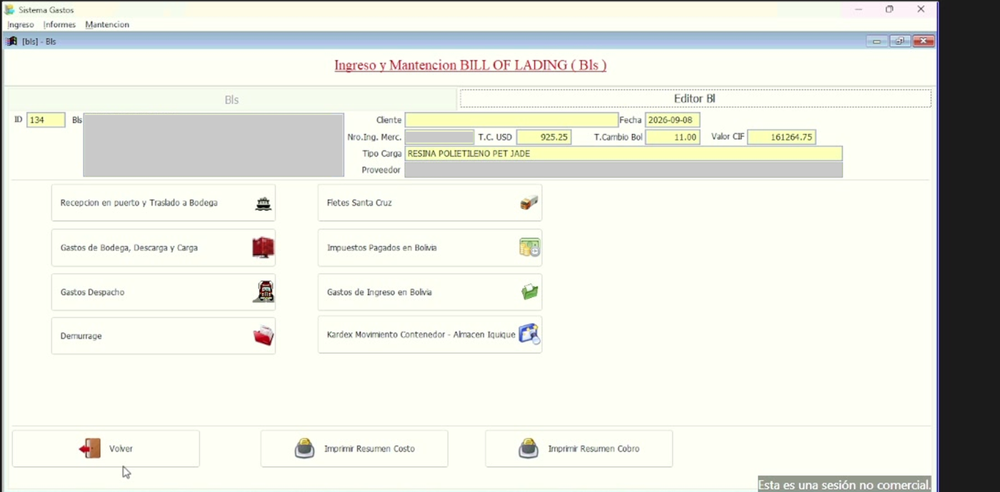
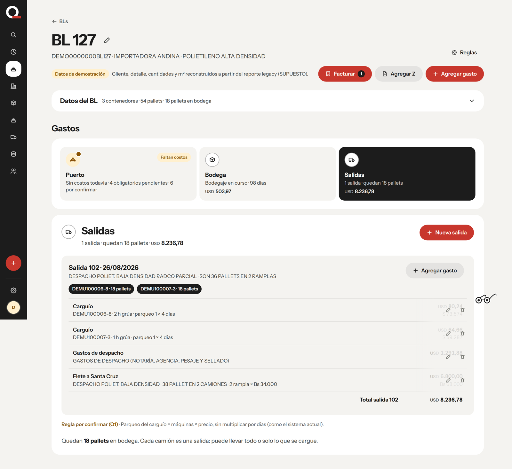
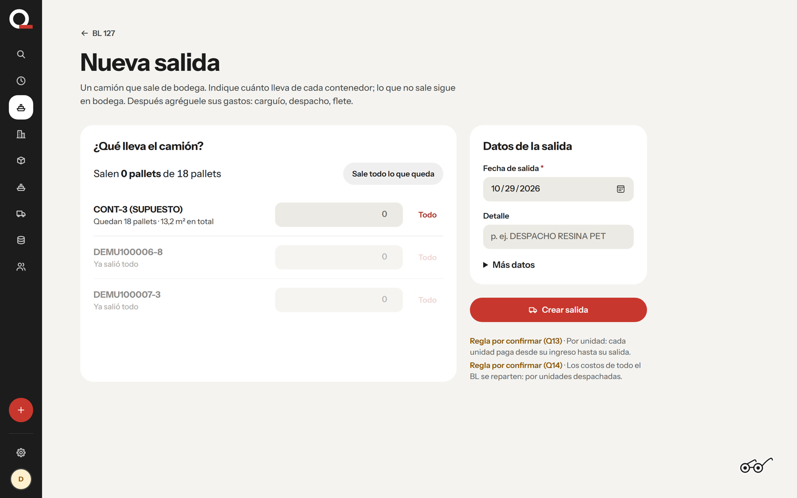
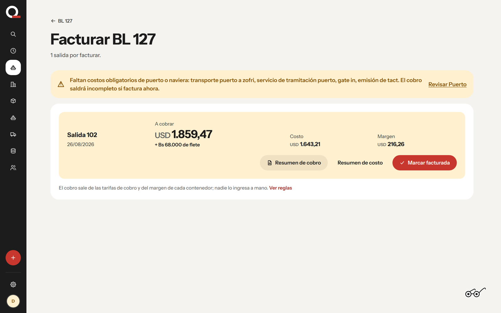
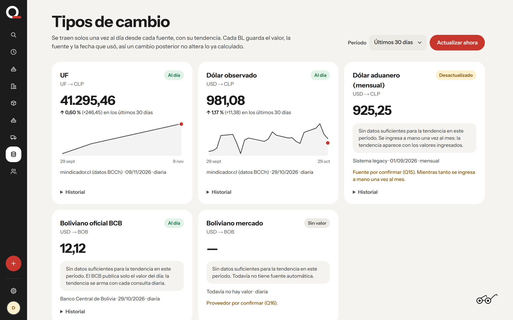
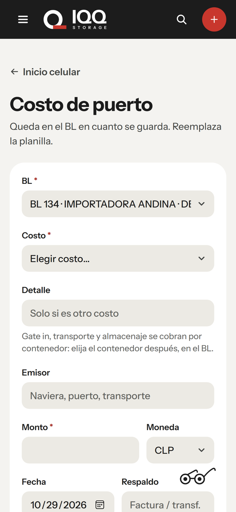

# Sistema Gastos — legacy system redesign

**Client:** a logistics company in Iquique, Chile. It imports goods into the ZOFRI free zone for Bolivian clients and trucks them to Santa Cruz.
**My role:** discovery, product spec, client validation, and building the v0. I also designed the company's new brand ([IQQ Storage brand case study](../iqq-storage-brand/)).
**Status:** v0 is live with the client. The validation call is underway.

## The problem

For every shipment (Bill of Lading), the company tracks what it costs them and what they charge the client. All of this runs in a Visual FoxPro desktop program on a single laptop that staff reach through AnyDesk. From the discovery call:

- **Partial shipments can't be recorded.** When only part of a shipment leaves, the leftover goods must keep accruing storage charges. The program can't handle this.
- **Port costs arrive late**, on a spreadsheet, and hold up billing.
- **Only one person, at one desk, can use it.** There is no mobile access and no access for the port agent, customs or the Bolivia office.
- **Exchange rates are typed in by hand**, with no record of their source.
- **Business risk:** all data sits on one laptop, and backups are unknown.

| Before: the legacy program | After: the v0 |
|---|---|
|  |  |
| One screen per cost category, reached through AnyDesk | One page per shipment, following it from arrival to billing |

## What I did

| Step | Document |
|---|---|
| Recorded a 32-minute working session with the main user and reverse-engineered the legacy system from it: data model, formulas, people and pain points | [Discovery findings](discovery-findings.md) |
| Wrote the PRD: problems with timestamped evidence, goals and non-goals, a mapping from every legacy screen to the new one (with screenshots), prioritized requirements, business rules, open questions, plan and success measures | [PRD](PRD.md) |
| Wrote the product brief: users, principles and constraints that guide design decisions | [Product brief](product-brief.md) |
| Built a working v0. Its numbers match the legacy system **to the cent**, checked by automated tests. Every unconfirmed business rule is a setting | — |
| Wrote a 45-minute script for the validation call. It goes screen by screen, with 26 questions in the client's language, and each answer maps to a setting | [Validation call script](validation-call-script.md) |
| Wrote the checklist of what stands between the demo and real use: what's done, what waits on the client, and what needs accounts | [Launch checklist](production-checklist.md) |

## The v0

| Partial departures | Billing, matching the legacy printout |
|---|---|
|  |  |
| Pick what leaves on each truck; the rest keeps accruing storage | USD 1,859.47, the same figure as the legacy billing summary |

| Exchange rates with their source | Phone modules for the port agent |
|---|---|
|  |  |
| Pulled daily from the central banks, with trend and date; each shipment keeps the rate it used | Costs entered at the port as they happen, replacing the late spreadsheet |

## Product choices worth noting

- **Follow the shipment, not the cost categories.** Every screen answers "where is this shipment and what is missing?"
- **Never ask for a number the system can calculate.** Billing, storage, currency conversions and exchange rates are all computed.
- **The legacy numbers are the contract.** The parity tests reproduce real legacy summaries (1,643.21 cost / 1,859.47 billing).
- **Assumptions are visible.** Each one shows on screen as "rule to confirm", so the client can correct it during the demo.

*Names of client staff and customers are replaced with role names. Screenshots use the demo data with fake client, supplier and container identifiers, and the legacy screenshots have those fields covered. The call transcript is not included.*
