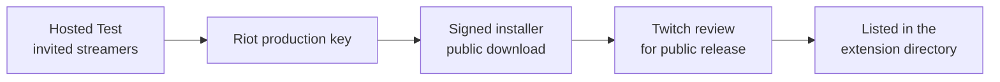

# Tabline — go-to-market plan

**Status:** draft plan, October 2026. Tabline is in Twitch Hosted Test with invited streamers. There are no user numbers, testimonials, streamer names or launch dates yet, and none are invented here.

## 1. The market and the gate

Tabline lives inside two platforms it doesn't control, so going to market is mostly about **passing gates in the right order**:

Each gate changes what we can promise. Until Riot grants the key, player cards run on a developer key that expires every 24 hours, so no public launch can be promised before then.

## 2. Who it's for

| Audience | Role in GTM | What they need to hear |
|---|---|---|
| **League streamers on Twitch** (any size, any region, Windows) | The buyer, at zero price: they install it | "Your viewers stop asking for the scoreboard. Setup takes minutes, no terminal." |
| **Viewers** (desktop Twitch) | The distribution: every stream shows it to everyone watching | "Hover the video. Everything on TAB, live." |
| **Riot and Twitch reviewers** | The gatekeepers | Clear, factual pages; policy compliance shown, not claimed |

Mobile viewers are out of reach: Twitch doesn't show video-overlay extensions on mobile.

## 3. Positioning

> For League streamers whose chat keeps asking "what's he building?", Tabline puts the live scoreboard over the stream, straight from the streamer's own game. Unlike delayed spectator tools or third-party estimates, it shows exactly what the streamer sees, and nothing they can't.

Brand rules that shape every message: Riot's rules come first; no Riot, League or Twitch logos; only claims the software backs up.

## 4. Pricing

Free for streamers and viewers: no ads, no subscriptions, no paid features, no data sold. Donations, if any, live on the website, because Twitch's review rejected donation links inside the extension.

## 5. Channels

| Channel | Why it fits | Status |
|---|---|---|
| **The overlay itself** | Every stream is a demo to every viewer; the credits line names the makers | Live in Hosted Test |
| **Invited streamers** | Hand-picked early users give feedback and visibility | Running now |
| **Website** ([tabline.pages.dev](https://tabline.pages.dev)) | One page that serves streamers and passes Riot's review | Live |
| **Showreel** | 15-second loop for the site hero and social clips | Done |
| **Twitch extension directory** | Discovery by streamers browsing extensions | After public release |
| **Streamer communities** (Discord, Reddit, League creator groups) | Where streamers trade tools | Planned for after the Riot key |

## 6. Launch phases

| Phase | Goal | Exit criteria |
|---|---|---|
| **0. Hosted Test** (now) | Prove it works stream after stream | Invited streamers run it every stream without reminders |
| **1. Riot key** | Player cards that don't expire daily | Production key granted |
| **2. Public download** | Anyone can install the companion | Code-signed installer, public download page, auto-update |
| **3. Public listing** | Discovery inside Twitch | Passed Twitch review; listed in the directory |
| **4. Grow** | Streamers recommend it to streamers | Installs arriving from viewers and other streamers |

## 7. How we'll know it's working

The success measures from the product brief, plus the funnel after public release:

| Stage | Metric |
|---|---|
| Habit | Streamers who run it on every stream, unprompted |
| Viewer value | Share of viewers who open the scoreboard; player-card opens per stream |
| Word of mouth | Mentions of Tabline in chat |
| Acquisition (post-listing) | Directory installs → companion downloads → first live stream |

Privacy limits what we can measure: there are no cookies, analytics or viewer tracking anywhere. Measurement relies on streamer reports and aggregate backend counts.

## 8. Risks

| Risk | Mitigation |
|---|---|
| Riot denies or delays the key | Compliance work done before applying; cards can be turned off; the core scoreboard needs no key |
| Twitch rejects the public submission | Website and listing written to Twitch's guidelines; links removed after the first review |
| Windows "unknown publisher" warning scares streamers | Code signing before public download; the website explains the warning in the meantime |
| Free-plan limits as usage grows | Updates sent on change, not on a timer; revisit hosting cost before public listing |
