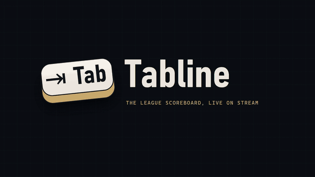
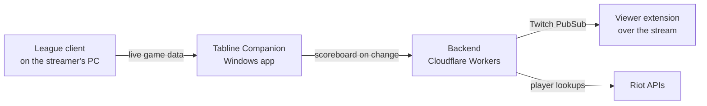
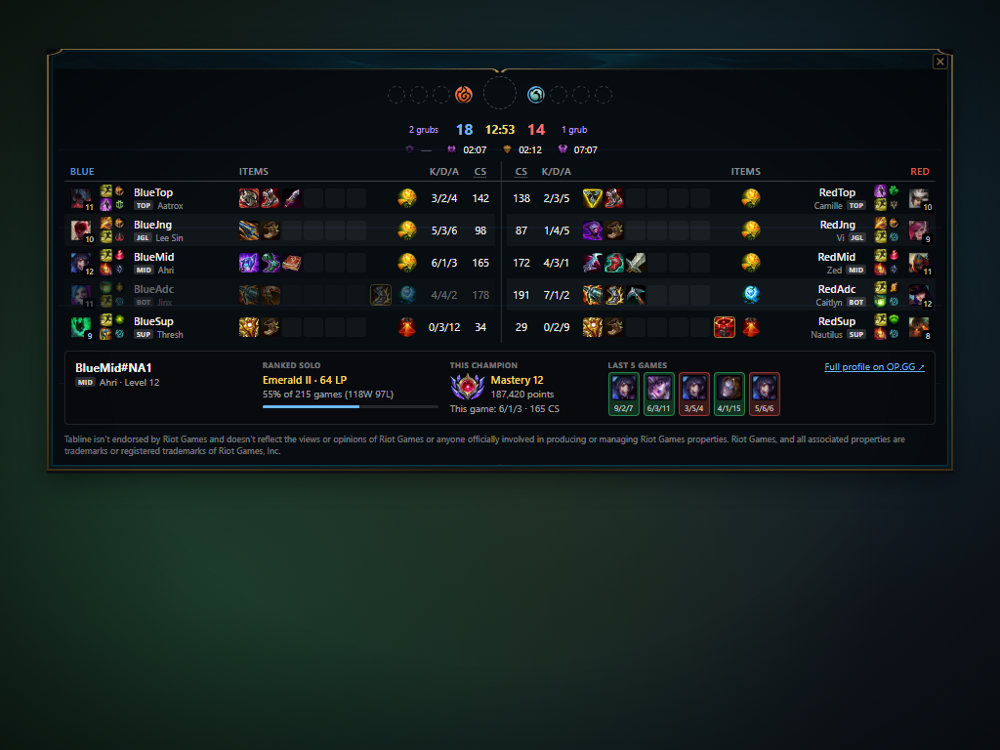
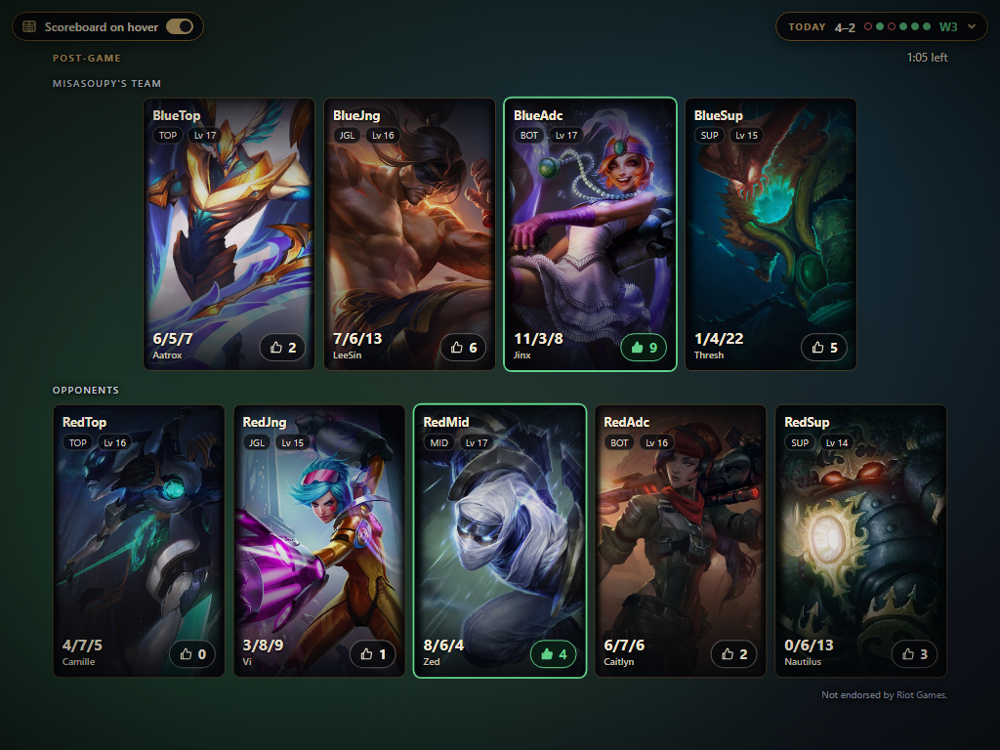
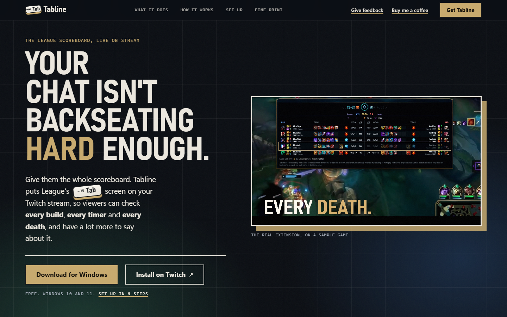
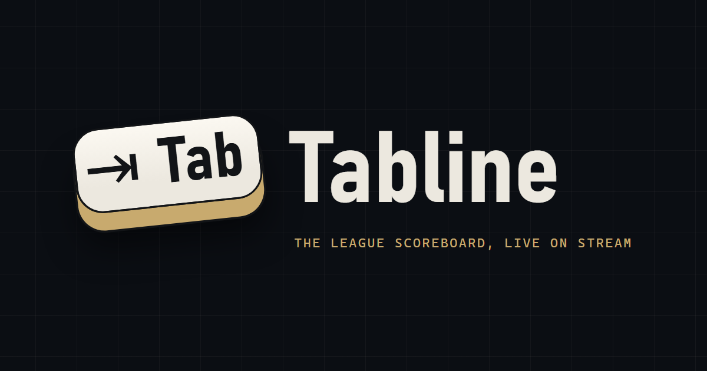

# Tabline — live League of Legends scoreboard for Twitch

**What it is:** a Twitch video-overlay extension. Viewers hover the stream to see both teams, items, runes, objectives and player cards, updated about a second after the game changes. It has four parts: the viewer extension, a Windows companion app for the streamer, a backend on Cloudflare Workers, and a public website.
**My role:** product owner and builder.
**Status:** in Twitch Hosted Test with invited streamers. The Riot production API key is in review.

## How it works

The scoreboard comes from the streamer's own game, so viewers see exactly what the streamer sees on TAB: not a delayed spectator feed, not a third-party estimate.

| The scoreboard | Player cards |
|---|---|
|  |  |
| **Post-game vote** | **The website** |
|  |  |

*All screenshots use a sample match with invented player names.*

## Product thinking

- **Three audiences, each with its own job:** streamers (setup must work without a terminal), viewers (install nothing, sign in to nothing), and gatekeepers. Riot and Twitch review the product as it stands, so the [website requirements](website-requirements.md) are written first to pass Riot's review.
- **Success measures defined up front:** Riot approves the key, invited streamers keep running it every stream without reminders, and viewers use the player cards and mention them in chat.
- **Policy work as product work:** before applying for the Riot key, I checked the product against Riot's developer policies and changed what didn't comply. Custom games are out of match history, players hidden by the game are never looked up, streamers can turn player cards off, and player IDs stay out of logs ([application draft](riot-production-key-application.md)).
- **Say only what is true:** the brand voice rules out claims the software can't back up, because Riot and Twitch read every word.

## Marketing and brand

- **Website:** built from a design brief based on an eight-topic interview (vibe, visitor journey, energy curve, signature move and more). The signature move: scrolling advances the match clock, so the real scoreboard fills in as you scroll. [Full page](images/website-full.png).
- **Showreel:** a 15-second motion piece rendered from the real viewer, used as the website hero and on social.
- **Store assets:** the Twitch listing icon set, discovery image and screenshots, plus a social card.

| Social card | Logo |
|---|---|
|  |  |

## Documents

- [Product brief](product-brief.md): users, purpose, success measures, positioning, principles
- [Go-to-market plan](GTM.md): from Hosted Test to the public extension directory
- [Website requirements](website-requirements.md): goals ranked by priority, audience needs, section-by-section content brief
- [Riot production key application](riot-production-key-application.md): compliance checklist and draft answers
