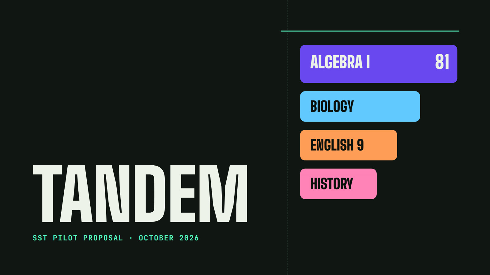
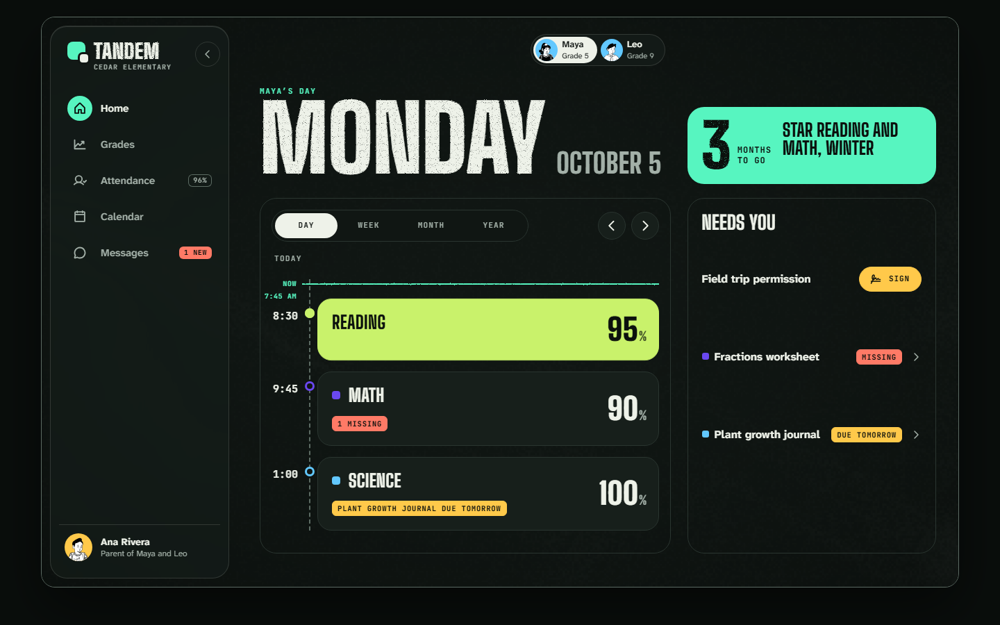
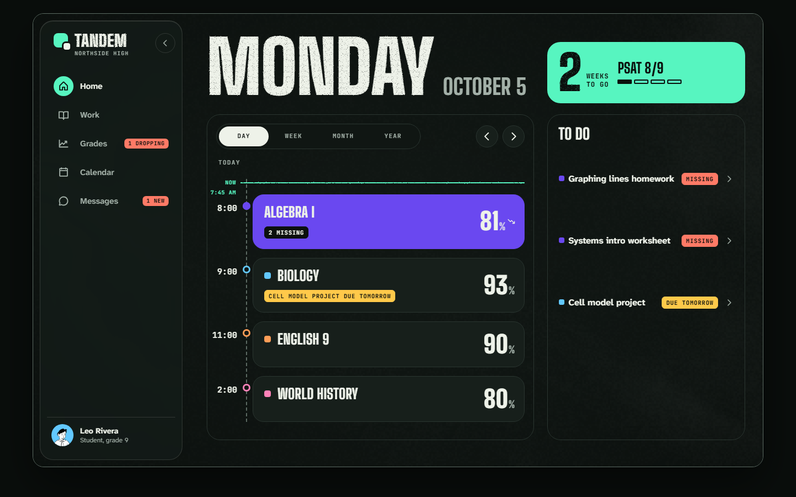
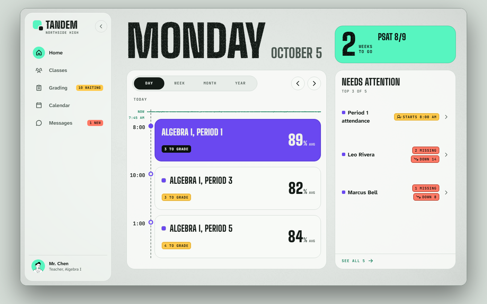
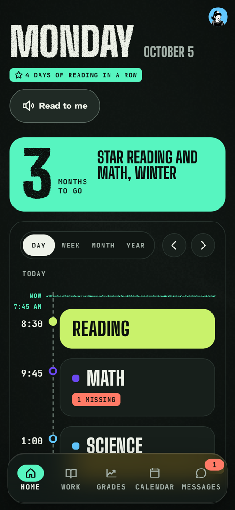
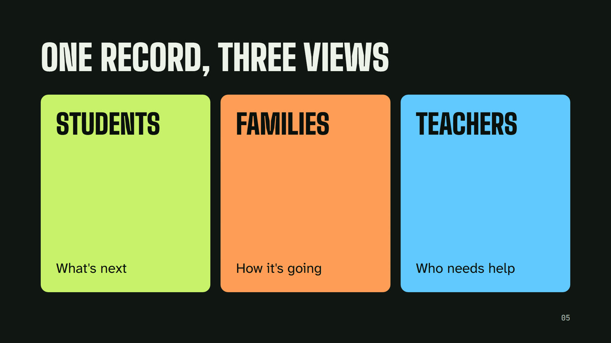
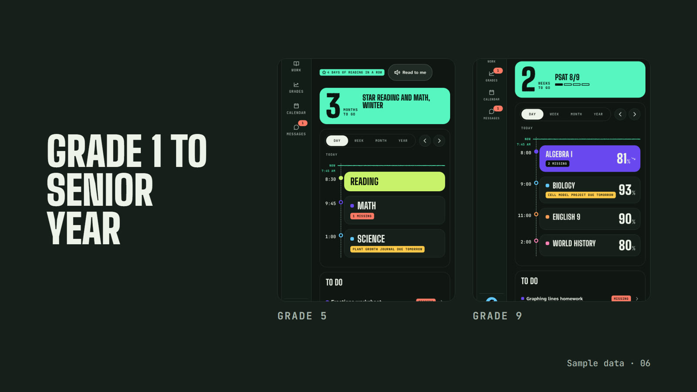
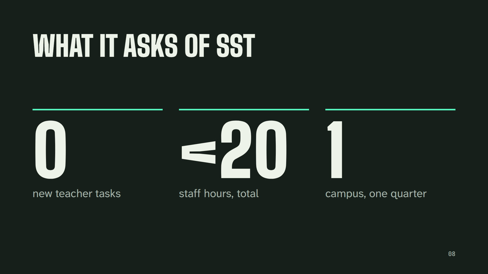
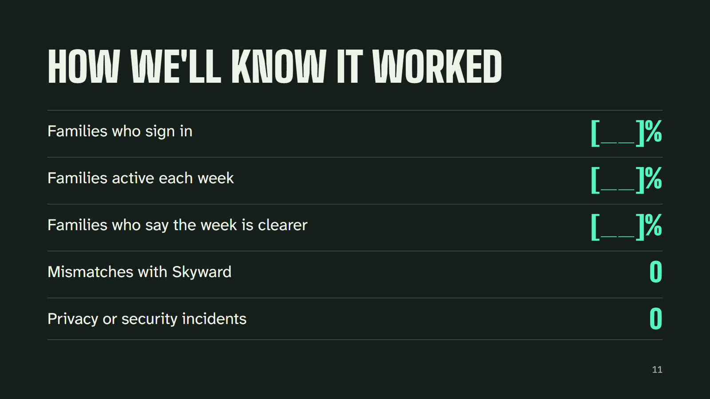
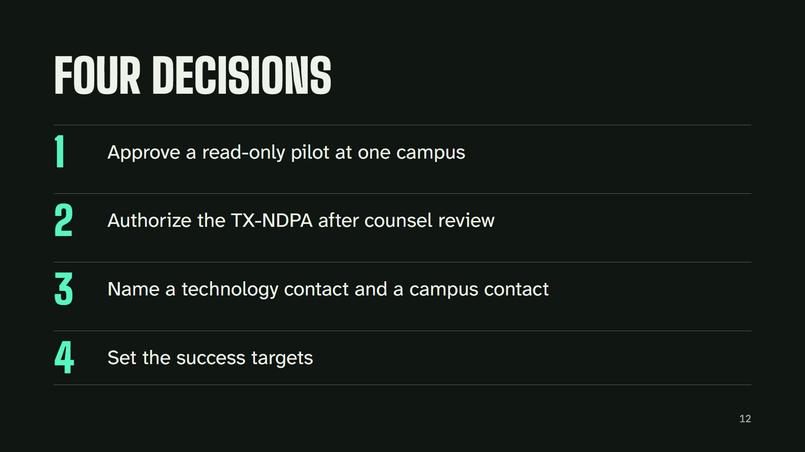

# Tandem — one school day for students, families and teachers

**What it is:** one app where a student, their family and their teachers see the same school day: classes, what's due, grades and upcoming tests. It sits on top of the systems a school already runs and replaces nothing.
**The pitch:** a read-only pilot at one campus of SST (School of Science and Technology, Texas), proposed to SST leadership in October 2026.
**My role:** product definition, prototype, the pitch deck, and the implementation and compliance plan.
**Status:** working prototype with sample data; pilot proposal submitted.

## The problem

"What does my child have this week?" Today an SST family needs four places to answer it: Skyward for grades and attendance, ParentSquare for messages, Clever to sign in, and PDFs for bell schedules.

## The product

One shared record, three views. A student sees what's next, a family sees how it's going, a teacher sees who needs help. Nobody ever sees a different version of the same grade or due date. The app also adapts by age: a 5th grader gets big touch targets, a reading streak and "Read to me"; a 9th grader gets grades, trends and a PSAT countdown.

| A parent's Monday | A 9th grader's Monday |
|---|---|
|  |  |
| **A teacher's Monday (light theme)** | **A 5th grader, on a phone** |
|  |  |

*Prototype with sample data. No SST data was used.*

## The pitch deck

A 13-slide deck for SST leadership that ends in four small, concrete decisions. None of them gives Tandem access to student data on its own.

| | |
|---|---|
|  |  |
|  |  |
|  |  |
|  |  |

## Go-to-market thinking

Selling to a school district is a trust sale, so the go-to-market is built around lowering risk for the people who say yes:

- **Land small:** one campus, one quarter, read-only, alongside every current tool ("shadow mode"). The school can stop at any time, and all data is deleted within 60 days.
- **Ask for almost nothing:** zero new teacher tasks and under 20 staff hours in total.
- **Compliance before data:** a hard gate. No real student data until FERPA, COPPA, the Texas data privacy agreement (TX-NDPA) and the rest of the matrix are signed off by counsel.
- **Let the board set the bar:** the board sets the adoption targets. Accuracy (zero mismatches with Skyward) and zero privacy incidents are fixed.
- **Expand from proof:** results go to the board in March, and the board decides what happens next.

## Documents

- [Implementation and compliance plan](implementation-and-compliance-plan.md): current systems, integration plan, a compliance matrix (FERPA, COPPA, PPRA, IDEA, ADA, Texas law), security program, privacy by design, accessibility, pilot timeline, risks and the decisions requested
