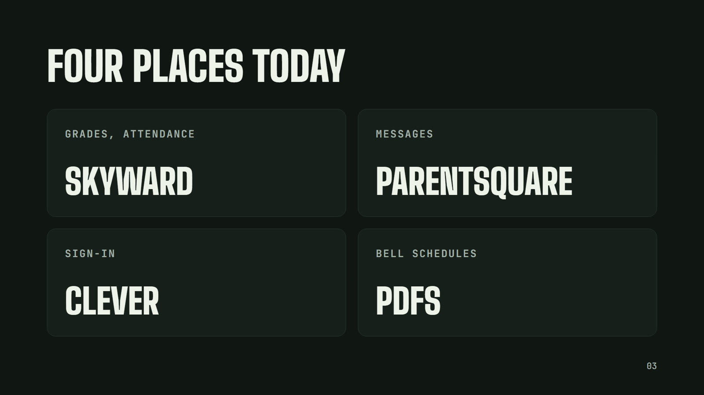
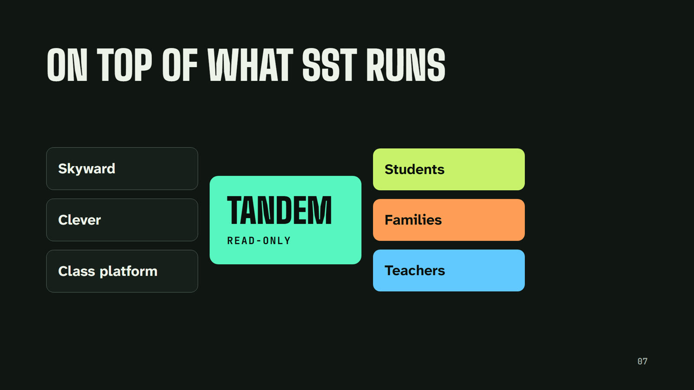
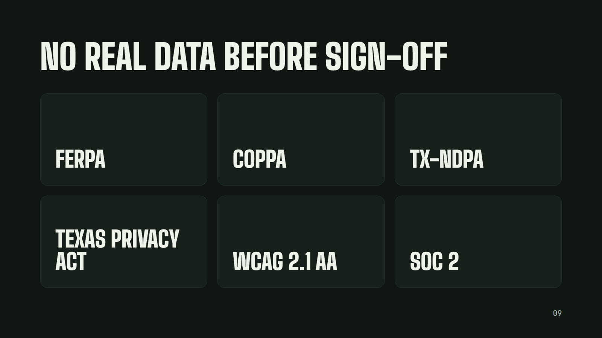
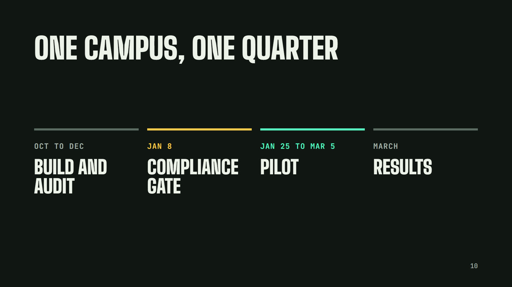

# Tandem at SST: Implementation and Compliance Plan

Oct 5, 2026 · Misa Escalera

## Summary

We propose a read-only pilot of Tandem at one SST campus. Tandem is one app where students, families and teachers see the school day, what is due, grades and upcoming tests in one place, built on top of the systems SST already runs.

- **What it replaces:** nothing. SST's student information system, learning platform and messaging tools stay the systems of record. Tandem reads from them and shows the result in one timeline.
- **What teachers do differently:** nothing in the pilot. No new data entry, no new gradebook.
- **What we ask of SST:** a signed data privacy agreement, approval of the sign-in connection (Clever or ClassLink), a data export or API access from SST's systems, and one campus contact. Estimated SST staff time: under 20 hours across the pilot.
- **Compliance stance:** no real student data enters Tandem until every requirement in the compliance matrix below is met, evidenced and reviewed by SST's counsel. The current Tandem build is a design prototype with sample data. It is not yet compliant and is not used with SST data.
- **Decisions requested:** see the last section.

## What SST families use today

SST families already move between at least four separate systems, and none of them shows the school day, what is due and what is coming up in one place. SST's [parent resources page](https://www.sstschools.org/parent-resources/) lists the first three below.

| Job | System at SST | Status |
| --- | --- | --- |
| Student information: schedules, attendance, grades, guardian contacts | Skyward (Family Access) | Confirmed |
| Messages and announcements | ParentSquare | Confirmed |
| Single sign-on and app launcher | Clever | Confirmed |
| Lunch menus | Nutrislice | Confirmed |
| Enrollment and applications | [SchoolMint](https://applyssttx.schoolmint.com/) | Confirmed |
| Classroom assignments and daily grading | Not known (Google Classroom or Canvas are common) | To confirm with SST |
| Benchmark testing | Not known (STAR, MAP or i-Ready are common) | To confirm with SST |
| College readiness testing (PSAT, SAT) | College Board | Assumed for high school |

The gap is not missing data. It is that a parent of a 6th grader has to open Skyward for grades, ParentSquare for messages and a PDF for the bell schedule, and still cannot answer "what does my child have this week?" in one look.

## How Tandem fits on SST's systems

Tandem is a layer on top of what SST runs, not a replacement: Skyward, Clever and the classroom platform stay the systems of record, and Tandem reads from them to show one view of the school day.

The scope layer is where compliance lives: every request is checked on the server against who is asking, so a guardian sees only the students Skyward links them to and a teacher only their own classes.

## Integration plan for SST

Everything Tandem shows can come from systems SST already runs, through standards Skyward is certified for, so SST does not build or re-enter anything. Skyward holds [OneRoster and 1EdTech data privacy certification](https://skyward.com/products/k-12-services/integrations) for SMS 2.0 and Qmlativ, and both products have held [Ed-Fi SIS API certification for Texas](https://www.ed-fi.org/technology-partners/skyward/), listed as valid through 2025.

| What Tandem shows | Source at SST | How it arrives | Pilot? |
| --- | --- | --- | --- |
| Students, teachers, classes, enrollments, terms | Skyward, already synced to Clever | Clever Secure Sync (OneRoster shape) | Yes |
| Bell schedules, calendar days, half days, holidays | Skyward | Ed-Fi API (BellSchedule, CalendarDate) or a nightly Skyward export | Yes |
| Guardians and who may see which student | Skyward guardian contacts, including custody and access restrictions | OneRoster 1.1 API or nightly export | Yes |
| Assignments, due dates, scores | Skyward gradebook or SST's classroom platform | OneRoster gradebook results, or the platform's API | Yes |
| Attendance | Skyward | Ed-Fi API or nightly export | Yes |
| STAR scores and testing windows | Renaissance | Scheduled file export | Phase 2 |
| PSAT and SAT scores | College Board reporting portal | Scheduled file export | Phase 2 |
| Messages | Tandem, or read from ParentSquare | Native first; no change to ParentSquare | Phase 2 |

**Sign-in.** Students and staff use the Clever login SST already has, so no new passwords. Families sign in with a one-time link sent to the email or phone already on file in Skyward; Tandem only shows a guardian the students Skyward links them to. Open question: whether SST prefers families sign in through Clever as well.

**Direction of data.** The pilot is read-only toward Skyward. Tandem never writes grades, attendance or contacts back. The only data Tandem creates is what people do inside it (a signed form, a checked prep step), and that stays exportable to SST.

## Compliance requirements

No SST student data enters Tandem until every row below reads "Counsel reviewed". Today every row is "Not started" or "In progress": the prototype uses sample data only. This list is our reading of the rules, not legal advice; SST's counsel should confirm it is complete.

| Requirement | What it requires of Tandem | Control that meets it | Owner | Evidence | Status |
| --- | --- | --- | --- | --- | --- |
| **FERPA** (20 U.S.C. 1232g; 34 CFR Part 99) | Act as a "school official" under SST's direct control; use records only for SST's purposes; no redisclosure; honor parent rights and the transfer of rights at age 18 | Signed DPA naming Tandem a school official; access only through Skyward-sourced relationships; age-18 rule in the scope check; directory opt-outs honored | Both | Signed DPA, access tests, audit log samples | Not started |
| **COPPA**, amended rule ([enforceable April 22, 2026](https://www.hunton.com/privacy-and-cybersecurity-law-blog/coppa-rule-amendment-compliance-deadline-approaches)) | Under-13 students use Tandem only with school authorization for school purposes; written data retention policy; no third-party disclosure for advertising | SST authorizes use in the DPA; no third-party sharing; published retention schedule; no advertising, ever | Both | DPA clause, retention policy, subprocessor list | Not started |
| **PPRA** (20 U.S.C. 1232h) | No surveys on protected topics without parent consent | Tandem has no surveys or questionnaires; adding one requires SST review | Tandem | Feature inventory | Not started |
| **IDEA and Section 504 records** | Special education and disability records stay protected | Pilot excludes IEP, 504, health and discipline data entirely | Both | Data inventory, sync filter tests | Not started |
| **ADA Title II and Section 504 accessibility** | WCAG 2.1 AA for web and mobile; DOJ moved the dates to [April 26, 2027 or April 26, 2028](https://www.jacksonlewis.com/insights/doj-extends-public-entities-compliance-deadline-ada-related-website-accessibility-hhss-may-2026-deadline-still-looms) by size | Meet WCAG 2.1 AA before the pilot regardless of SST's date | Tandem | Accessibility Conformance Report, test results | In progress |
| **Title VI language access** | Families with limited English get meaningful access | Spanish interface at launch; translated messages labeled as translated | Tandem | Translation coverage report | Not started |
| **Texas Student Privacy Act** (Tex. Educ. Code [Ch. 32, Subch. D](https://texas.public.law/statutes/tex._educ._code_section_32.151)) | No targeted ads, no profiles for marketing, no sale of student data; reasonable security; delete on SST's request | No ads or data sales in the product or contracts; security program below; deletion within 60 days of request | Tandem | Contract terms, deletion runbook and test | In progress |
| **Texas SCOPE Act** (HB 18) | Duties for digital services used by minors; whether it reaches a service a school contracts for is a question for counsel ([overview of the Act](https://katten.com/texas-legislates-new-requirements-for-online-interactions-with-minors)) | Counsel determines whether it applies; the design meets its duties either way (no ads, no public profiles, no contact with strangers) | Both | Counsel memo | Not started |
| **Texas breach notification** (Bus. and Com. Code [521.053](https://codes.findlaw.com/tx/business-and-commerce-code/bus-com-sect-521-053/)) | A custodian notifies the data owner immediately; individuals within 60 days; the Attorney General within 30 days if 250 or more Texans | Tandem notifies SST immediately (target within 24 hours) and supports SST's notices | Both | Incident response plan, tabletop exercise | Not started |
| **Texas HB 1481** (student devices) | SST must ban personal device use during the school day ([a district summary of HB 1481](https://www.comalisd.org/apps/pages/HB1481)) | No student notifications during bell-schedule hours; nothing in Tandem requires a phone at school | Tandem | Notification rules, test log | Not started |
| **Texas student data privacy agreement** (TX-NDPA, [Texas Student Privacy Alliance](https://www.tetl.org/cpages/texas-student-data-privacy-alliance)) | Standard Texas contract terms, including U.S. data storage and a named cybersecurity framework | Sign the TX-NDPA with its Texas exhibit; offer it to all Texas schools (Exhibit E) | Tandem | Signed agreement | Not started |
| **SST board policy and vendor terms** | SST's local technology, records and vendor policies; Skyward and Clever data-sharing terms | Review with SST before data access; Clever app approval by SST | SST | Approval record | Not started |
| **Security program** | "Reasonable security" under state law and the DPA | The program in the next section, audited | Tandem | SOC 2 Type II report, penetration test | Not started |

## Security program

Tandem's security program is built to be audited: every control below produces evidence SST can review, and an independent SOC 2 audit confirms it. The framework is NIST CSF 2.0, which the TX-NDPA asks vendors to name.

| Area | Control |
| --- | --- |
| Hosting | U.S. data centers only, including backups and logs. Each school's data is partitioned and never mixed in queries. |
| Encryption | TLS 1.2 or higher in transit; AES-256 at rest; keys in a managed key service with rotation. |
| Who can see what | Every request is checked on the server against the person's scope: a student sees only themselves, a guardian only the students Skyward links them to, a teacher only their rosters. Custody and access restrictions in Skyward are honored. Automated tests cover every role. |
| Tandem staff access | No standing access to student data. Support access needs an SST-opened ticket, uses multi-factor sign-in, is time-limited and is logged. |
| Audit logs | Every staff read of student records and every admin action is logged, kept one year, and available to SST on request. |
| Vulnerability management | Dependency and code scanning on every build; an independent penetration test before the pilot and yearly after. |
| Incident response | Written plan, tested yearly. Tandem notifies SST immediately on discovering a breach, and in all cases within 24 hours, then supports SST's notices under Texas law. |
| Subprocessors | A published list; SST notified 30 days before any change; each bound by terms at least as strict as the DPA. |
| Backups and recovery | Encrypted daily backups in the U.S.; restores tested quarterly. |
| People | Background checks and yearly privacy and security training for anyone who can reach student data. |
| Independent proof | SOC 2 Type I before the pilot; Type II within 12 months; 1EdTech TrustEd Apps data privacy certification. |

## Privacy by design

Tandem holds only the data its screens show, keeps it only while SST is a customer, and never uses it for anything but SST's purposes.

| Data | Why Tandem needs it | Source |
| --- | --- | --- |
| Student first and last name, grade, campus | Show the right student to the right people | Skyward via Clever |
| Class schedule, rooms, teachers | The day view and class pages | Skyward |
| Bell schedules and calendar days | Correct times on regular days, Short Wednesdays, half days and holidays | Skyward |
| Assignments, due dates, scores, grades | To do, grade trends, alerts | Skyward gradebook or classroom platform |
| Attendance | Attendance view | Skyward |
| Guardian name, email or phone, linked students | Family sign-in and who may see which student | Skyward |
| Testing windows and scores (phase 2) | Countdowns and goals | Renaissance, College Board |
| Activity inside Tandem (sign-ins, signed forms, checked prep steps, messages) | The product working | Tandem |

**Never collected:** Social Security numbers, home addresses, birthdates (only an "18 or older" flag), health, discipline, special education or 504 records, location, biometrics, photos of K-8 students, device contacts.

**Never done with student data:**

- No advertising of any kind, targeted or not, and no sale or rental of data.
- No profiles beyond SST's school purposes.
- No training of AI or machine-learning models, and no AI features in the pilot.
- No third-party analytics, ad or tracking code in any student or family screen. Product analytics are de-identified and aggregated.

**Retention and deletion.** Data is deleted within 60 days of SST's request or the end of the contract, with a written certificate of deletion. Backups age out within 35 days of that.

**Family rights.** Parents and eligible students exercise FERPA rights through SST, as they do today. Tandem answers any SST request to export, correct or delete a record within 10 business days, so SST can meet its own 45-day FERPA deadline.

## Accessibility

Tandem will meet WCAG 2.1 AA on web and mobile before any SST family uses it, whatever SST's own ADA Title II deadline turns out to be. The DOJ's April 20, 2026 interim rule moved those deadlines to April 26, 2027 for entities of 50,000 people or more and April 26, 2028 for smaller ones ([source](https://www.jacksonlewis.com/insights/doj-extends-public-entities-compliance-deadline-ada-related-website-accessibility-hhss-may-2026-deadline-still-looms)); counsel should confirm which applies to SST.

- **Already in the design:** text contrast checked in both themes (main text 15:1 or better, secondary 6:1 or better), every status shown in words and not color alone, visible keyboard focus, a skip link, reduced-motion versions of all motion, touch targets of 44 to 56 pixels by grade band, and a body typeface built for low-vision readers.
- **Testing before the pilot:** automated checks on every build; manual testing with keyboard only, VoiceOver, TalkBack and NVDA; a review by people who use assistive technology.
- **Evidence:** a published Accessibility Conformance Report (VPAT 2.5) listing any known gaps and their fix dates.
- **Languages:** English and Spanish at launch, including every notification. Teacher messages are translated automatically and labeled as translated.

## Pilot plan and timeline

The pilot runs one campus for SST's third quarter, January 25 to March 5, 2027, and only after the compliance gate on January 8. Every date is a target the board can move.

Before the gate, Tandem is built and audited with sample data only; after it, real data is connected read-only and checked against Skyward before any family sees it.

| Who at SST | Pilot work | Estimated time |
| --- | --- | --- |
| Counsel | Review the TX-NDPA and the compliance matrix | Set by counsel |
| Technology lead | Approve the Clever app, enable the Skyward API or export | 6 hours |
| Campus contact | Invite families through ParentSquare, gather feedback | 8 hours |
| Leadership | Kickoff, midpoint check-in, results review | 4 hours |

**Shadow mode.** Skyward Family Access and ParentSquare keep running unchanged. No family or teacher loses a tool they use today.

**Success measures (proposed):** share of invited families who sign in, weekly active families, family-reported clarity in a short survey of parents, accuracy of schedules and grades against Skyward (target: no mismatches in weekly spot checks), and zero privacy or security incidents.

**Exit.** SST can end the pilot at any time. Tandem deletes all SST data within 60 days and provides a certificate of deletion.

## Risks and open questions

The biggest risk is starting before the compliance work is done; the plan blocks that with a hard gate, so the remaining risks are about fit and adoption.

| Risk | Mitigation |
| --- | --- |
| Real data reaches Tandem before controls are proven | Hard gate: no data until every compliance row is "Counsel reviewed" and SST signs off in writing |
| Tandem shows something different from Skyward (a wrong time, a missing grade) | Skyward stays the record; nightly checks compare samples; any mismatch pauses the affected view |
| A guardian sees a student they should not (custody orders) | Access comes only from Skyward relationships and restriction flags; tested for every role before launch |
| Students reach for phones during school | No student notifications during bell hours, in line with SST's HB 1481 policy |
| Families see one more app | Tandem replaces the need to open Skyward, ParentSquare and PDFs for daily questions; invitations go through ParentSquare SST already uses |
| Teachers feel watched (class pulse, attention lists) | Class views are for teachers about their own classes, never used for evaluation; confirmed in writing |

**Open questions for SST and counsel:**

- [ ] Which Skyward product does SST run (SMS 2.0 or Qmlativ), is the Ed-Fi or OneRoster API enabled, and is Skyward's Ed-Fi certification current?
- [ ] Which classroom platform and benchmark test (STAR, MAP, i-Ready) do SST campuses use?
- [ ] Does SST's ADA Title II deadline fall on April 26, 2027 or April 26, 2028?
- [ ] Does the Texas SCOPE Act apply to Tandem as a service SST contracts for, and if so, which duties?
- [ ] Which SST board policies govern vendor data access, and who approves the Clever app?
- [ ] Which campus hosts the pilot, and which grades?

## Decisions requested from the board

We ask the board for four approvals, none of which grants access to student data on its own:

1. Approve a read-only pilot of Tandem at one SST campus, starting no earlier than the compliance gate.
2. Authorize SST staff to negotiate and sign the TX-NDPA with Tandem, after counsel review.
3. Name an SST owner for the pilot: one technology contact and one campus contact.
4. Set the success measures the board wants reported at the end of the pilot.

## Sources

- SST: [Parent resources](https://www.sstschools.org/parent-resources/) (Skyward, ParentSquare, Clever, Nutrislice)
- Skyward: [Interoperability and integrations](https://skyward.com/products/k-12-services/integrations); [Ed-Fi technology partner listing](https://www.ed-fi.org/technology-partners/skyward/)
- ADA Title II: [DOJ interim final rule extending compliance dates](https://www.jacksonlewis.com/insights/doj-extends-public-entities-compliance-deadline-ada-related-website-accessibility-hhss-may-2026-deadline-still-looms)
- COPPA: [Amended rule compliance date](https://www.hunton.com/privacy-and-cybersecurity-law-blog/coppa-rule-amendment-compliance-deadline-approaches)
- Texas Student Privacy Act: [Overview of Tex. Educ. Code 32.151](https://www.cybernut.com/blog/what-to-know-about-the-texas-student-privacy-act-ed-code-32-151)
- Texas breach notification: [Bus. and Com. Code 521.053](https://codes.findlaw.com/tx/business-and-commerce-code/bus-com-sect-521-053/)
- Texas HB 1481: [District implementation summary](https://www.comalisd.org/apps/pages/HB1481)
- Texas SCOPE Act: [Overview of HB 18](https://katten.com/texas-legislates-new-requirements-for-online-interactions-with-minors)

This plan is a working reading of the rules as of October 2026, not legal advice.
